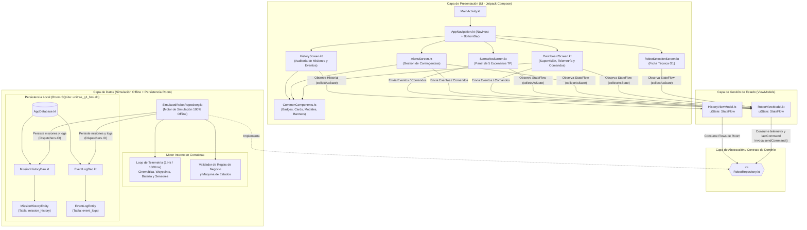
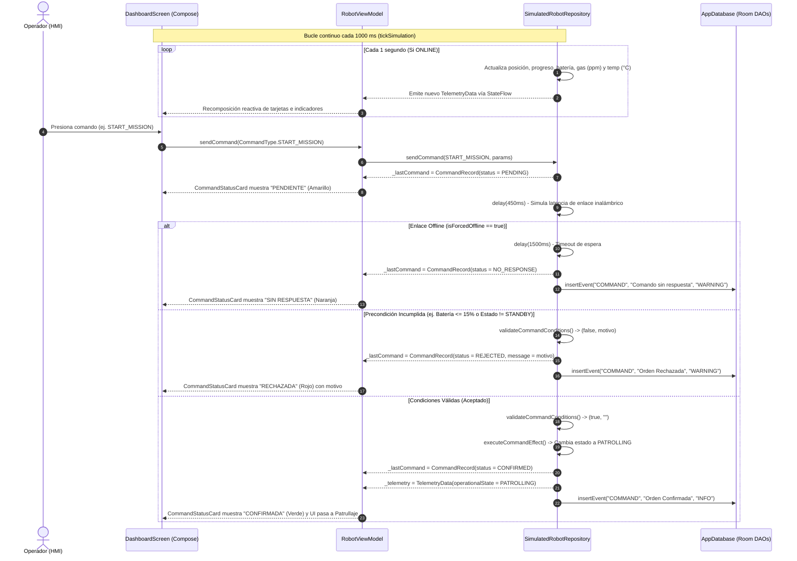
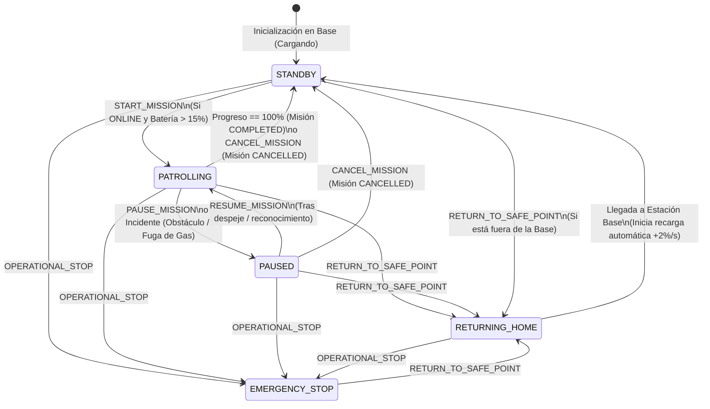
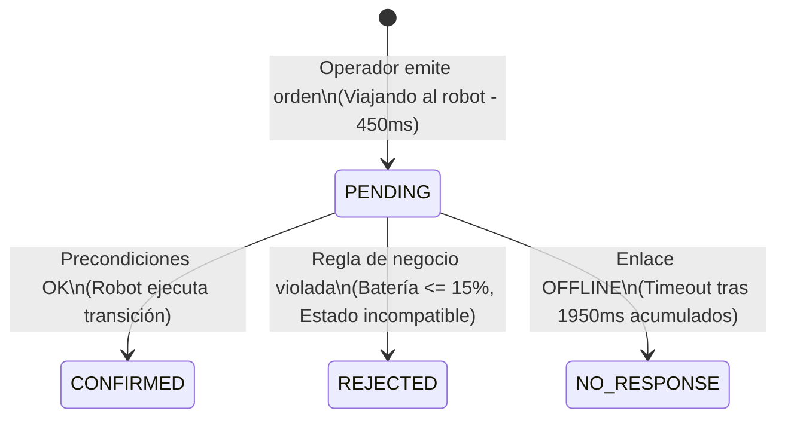

# Arquitectura de Software, Repository Simulado y Contratos de Mensajes
**Proyecto:** Interfaz HMI/HRI para Robot de Servicio Unitree G1 (`unitreeg1hmi99`)  
**Cátedra:** Desarrollo de Aplicaciones I — Facultad de Ingeniería y Cs. Exactas, UADE  
**Plataforma Robótica:** Unitree G1 (Humanoide Bípedo)  
**Paquete Base:** `ar.edu.uade.unitreeg1hmi99`  

---

## Índice
1. [Diagramas de Arquitectura](#1-diagramas-de-arquitectura)
   - [1.1. Diagrama General de Capas (MVVM + Clean Architecture)](#11-diagrama-general-de-capas-mvvm--clean-architecture)
   - [1.2. Flujo Unidireccional de Datos (UDF) y Secuencia de Comandos](#12-flujo-unidireccional-de-datos-udf-y-secuencia-de-comandos)
   - [1.3. Máquina de Estados Operativos y Ciclo de Vida de Órdenes](#13-máquina-de-estados-operativos-y-ciclo-de-vida-de-órdenes)
   - [1.4. Estructura de Paquetes del Proyecto](#14-estructura-de-paquetes-del-proyecto)
2. [Repository Simulado (`RobotRepository` y `SimulatedRobotRepository`)](#2-repository-simulado-robotrepository-y-simulatedrobotrepository)
   - [2.1. Desacoplamiento mediante Interfaz (`RobotRepository.kt`)](#21-desacoplamiento-mediante-interfaz-robotrepositorykt)
   - [2.2. Motor de Simulación 100% Offline (`SimulatedRobotRepository.kt`)](#22-motor-de-simulación-100-offline-simulatedrobotrepositorykt)
   - [2.3. Código del Repository Simulado](#23-código-del-repository-simulado)
3. [Ejemplos de Mensajes (Contratos JSON Simulados)](#3-ejemplos-de-mensajes-contratos-json-simulados)
   - [3.1. Mensajes de Telemetría (Robot $\rightarrow$ HMI)](#31-mensajes-de-telemetría-robot--hmi)
   - [3.2. Mensajes de Comandos (HMI $\rightarrow$ Robot)](#32-mensajes-de-comandos-hmi--robot)
   - [3.3. Mensajes de Respuesta de Comandos (Robot $\rightarrow$ HMI)](#33-mensajes-de-respuesta-de-comandos-robot--hmi)
   - [3.4. Registros de Persistencia y Auditoría Local (Room SQLite)](#34-registros-de-persistencia-y-auditoría-local-room-sqlite)

---

## 1. Diagramas de Arquitectura

La aplicación sigue el patrón **MVVM (Model-View-ViewModel)** con principios de **Clean Architecture** y **Flujo Unidireccional de Datos (UDF)** sobre **Jetpack Compose** y **Kotlin Coroutines / StateFlow**.

### 1.1. Diagrama General de Capas (MVVM + Clean Architecture)



#### Responsabilidades por Capa:
1. **Capa UI (`ui/screens`, `ui/components`, `ui/navigation`):**
   - Renderiza declarativamente el estado expuesto por los ViewModels mediante `collectAsState()`.
   - Nunca modifica el estado directamente ni contiene lógica de negocio; únicamente emite intenciones del operador (`sendCommand`, `acknowledgeAlert`, `selectMission`).
2. **Capa ViewModel (`ui/viewmodel`):**
   - [`RobotViewModel`](file:///d:/androidProjects/unitreeg1hmi99/app/src/main/java/ar/edu/uade/unitreeg1hmi99/ui/viewmodel/RobotViewModel.kt) combina los flujos `telemetry` y `lastCommand` del repositorio con el estado propio de la vista (modales de confirmación, misión seleccionada) en un único `StateFlow<RobotUiState>` inmutable.
   - [`HistoryViewModel`](file:///d:/androidProjects/unitreeg1hmi99/app/src/main/java/ar/edu/uade/unitreeg1hmi99/ui/viewmodel/HistoryViewModel.kt) expone reactivamente las tablas de misiones y eventos almacenadas en Room.
3. **Capa Repository (`data/repository`):**
   - [`RobotRepository`](file:///d:/androidProjects/unitreeg1hmi99/app/src/main/java/ar/edu/uade/unitreeg1hmi99/data/repository/RobotRepository.kt) define el contrato estricto de comunicación. Si en el futuro se conecta el SDK real de Unitree G1 (vía WebSocket/DDS/REST), solo se crea `NetworkRobotRepository` implementando esta misma interfaz, sin alterar ni una línea de los ViewModels ni de la UI.
   - [`SimulatedRobotRepository`](file:///d:/androidProjects/unitreeg1hmi99/app/src/main/java/ar/edu/uade/unitreeg1hmi99/data/repository/SimulatedRobotRepository.kt) ejecuta el motor de simulación 100% offline.
4. **Capa de Persistencia Local (`data/local`):**
   - [`AppDatabase`](file:///d:/androidProjects/unitreeg1hmi99/app/src/main/java/ar/edu/uade/unitreeg1hmi99/data/local/AppDatabase.kt) gestiona la base SQLite local `unitree_g1_hmi.db` mediante Room, asegurando trazabilidad histórica de misiones completadas/canceladas y auditoría de comandos y alertas.

---

### 1.2. Flujo Unidireccional de Datos (UDF) y Secuencia de Comandos

El siguiente diagrama de secuencia muestra cómo fluye una orden discreta desde que el operador presiona un botón en la pantalla hasta que el repositorio simulado valida las precondiciones, actualiza la máquina de estados, persiste la auditoría en Room y refresca la UI:



---

### 1.3. Máquina de Estados Operativos y Ciclo de Vida de Órdenes

#### Máquina de Estados del Robot (`OperationalState`)



#### Ciclo de Vida de cada Comando (`CommandStatus`)



---

### 1.4. Estructura de Paquetes del Proyecto

```text
ar.edu.uade.unitreeg1hmi99/
├── MainActivity.kt                        # Punto de entrada e inyección de dependencias
├── data/
│   ├── local/
│   │   ├── AppDatabase.kt                 # Instancia Singleton Room (unitree_g1_hmi.db)
│   │   ├── dao/
│   │   │   ├── MissionHistoryDao.kt       # Consultas Flow<List<MissionHistoryEntity>>
│   │   │   └── EventLogDao.kt             # Consultas Flow<List<EventLogEntity>>
│   │   └── entity/
│   │       ├── MissionHistoryEntity.kt    # Tabla mission_history
│   │       └── EventLogEntity.kt          # Tabla event_logs
│   ├── model/
│   │   ├── TelemetryData.kt               # Modelo inmutable con las 8+3 variables de telemetría
│   │   └── RobotEnums.kt                  # OperationalState, ConnectionState, CommandType, CommandStatus, AlertItem
│   └── repository/
│       ├── RobotRepository.kt             # Interfaz desacoplada del repositorio
│       └── SimulatedRobotRepository.kt    # Motor de simulación autónomo 100% offline
└── ui/
    ├── components/
    │   └── CommonComponents.kt            # Badges, tarjetas de telemetría, modales y banners HRI
    ├── navigation/
    │   └── AppNavigation.kt               # NavHost con las 5 pantallas y barra inferior
    ├── screens/
    │   ├── RobotSelectionScreen.kt        # Ficha técnica del Unitree G1 y sensores
    │   ├── DashboardScreen.kt             # Supervisión en vivo, selector de misión y botonera
    │   ├── AlertsScreen.kt                # Bandeja de alertas activas y reconocimiento
    │   ├── HistoryScreen.kt               # Historial persistido en Room (Misiones y Eventos)
    │   └── ScenariosScreen.kt             # Disparadores de los 5 escenarios obligatorios del TP
    ├── theme/
    │   ├── Color.kt
    │   ├── Theme.kt
    │   └── Type.kt
    └── viewmodel/
        ├── RobotViewModel.kt              # Estado reactivo principal y despacho de órdenes
        └── HistoryViewModel.kt            # Observación de historial Room
```

---

## 2. Repository Simulado (`RobotRepository` y `SimulatedRobotRepository`)

### 2.1. Desacoplamiento mediante Interfaz (`RobotRepository.kt`)

La arquitectura aísla por completo la fuente de datos detrás de la interfaz [`RobotRepository`](file:///d:/androidProjects/unitreeg1hmi99/app/src/main/java/ar/edu/uade/unitreeg1hmi99/data/repository/RobotRepository.kt). Los ViewModels dependen únicamente de esta abstracción:

```kotlin
package ar.edu.uade.unitreeg1hmi99.data.repository

import ar.edu.uade.unitreeg1hmi99.data.local.entity.EventLogEntity
import ar.edu.uade.unitreeg1hmi99.data.local.entity.MissionHistoryEntity
import ar.edu.uade.unitreeg1hmi99.data.model.CommandRecord
import ar.edu.uade.unitreeg1hmi99.data.model.CommandType
import ar.edu.uade.unitreeg1hmi99.data.model.TelemetryData
import kotlinx.coroutines.flow.Flow
import kotlinx.coroutines.flow.StateFlow

interface RobotRepository {
    /** Flujo continuo de telemetría dinámica en tiempo real (1 Hz) */
    val telemetry: StateFlow<TelemetryData>

    /** Registro de la última orden emitida y su estado (PENDING, CONFIRMED, REJECTED, NO_RESPONSE) */
    val lastCommand: StateFlow<CommandRecord?>

    /** Emisión de comandos con validación de condiciones de habilitación y simulación de respuesta */
    suspend fun sendCommand(type: CommandType, parameters: Map<String, String> = emptyMap()): CommandRecord

    /** Reconocimiento individual de alertas por parte del operador */
    suspend fun acknowledgeAlert(alertId: String)

    /** Desestimar modal de misión completada tras tomar una decisión */
    fun dismissMissionCompleted()

    /** Flujos reactivos de persistencia local en Room */
    fun getMissionHistory(): Flow<List<MissionHistoryEntity>>
    fun getEventLogs(): Flow<List<EventLogEntity>>
    suspend fun clearHistory()

    // --- Disparadores para demostración de los 5 escenarios de prueba de la consigna ---
    fun toggleDisconnection(forceOffline: Boolean)
    fun triggerLowBattery(percentage: Int = 12)
    fun triggerObstacleIncident()
    fun triggerServiceAlert(gasPpm: Double = 98.0, tempCelsius: Double = 52.0)
    fun toggleForceRejectCommands(reject: Boolean)
    fun resetSimulation()
}
```

---

### 2.2. Motor de Simulación 100% Offline (`SimulatedRobotRepository.kt`)

La clase [`SimulatedRobotRepository`](file:///d:/androidProjects/unitreeg1hmi99/app/src/main/java/ar/edu/uade/unitreeg1hmi99/data/repository/SimulatedRobotRepository.kt) reemplaza al robot físico y al servidor externo mediante un motor determinístico y reactivo ejecutado en `CoroutineScope(Dispatchers.Default)`:

1. **Mapa de Recorrido y Waypoints Internos:**
   - Define la `baseStation` en `(0.0, 0.0)` ("Estación Base de Carga") y una ruta de **8 Waypoints** que recorren el edificio (Pabellón A, Pasillo de Aulas 101-105, Laboratorio de Robótica e IoT, Sala de Servidores y Tablero B, Salida de Emergencia Este, Depósito de Mantenimiento, Pasillo Sur - Oficinas y Punto Final de Inspección).
2. **Bucle de Reloj (`tickSimulation` cada 1000 ms):**
   - **Simulación de Desconexión (`isForcedOffline == true`):** Congela los valores de telemetría, cambia `connectionState = ConnectionState.OFFLINE` y activa la bandera `isDataStale = true` para que la UI advierta al operador que los datos en pantalla son antiguos.
   - **Gestión Dinámica de Batería:** En estado `PATROLLING` consume batería gradualmente y ajusta el voltaje proporcionalmente entre `24.0V` y `25.2V`. Cuando el robot está en `STANDBY` dentro de la Estación Base, activa `isCharging = true` y regenera `+2%` por segundo. Si la batería cae a $\le 15\%$, inyecta automáticamente la alerta `BATTERY_LOW` (`WARNING`).
   - **Cinemática de Patrullaje y Retorno:**
     - En `PATROLLING`: incrementa `missionProgress` en `+3.5%` por segundo, interpola el waypoint actual (`1..8`), actualiza coordenadas `(posX, posY)`, velocidad (`~0.85 m/s`) y orientación (`headingDeg`). Al llegar al `100%`, detiene el robot en el último punto, dispara el evento `justCompletedMissionName` y guarda la misión en Room como `COMPLETED`.
     - En `RETURNING_HOME`: reduce la distancia hacia la base a `0.70 m/s` hasta acoplarse en `(0.0, 0.0)`, pasando a `STANDBY` e iniciando la recarga.
   - **Variables Ambientales del Servicio:** Genera oscilaciones realistas de gas/humo (`12.0 - 15.0 ppm`) y temperatura (`21.0 - 22.5 °C`), registrando los picos máximos (`maxRecordedGas` y `maxRecordedTemp`) para guardarlos en el historial de Room al finalizar cada ronda.
3. **Validación de Condiciones de Negocio (`validateCommandConditions`):**
   - Verifica en el backend simulado que cada orden cumpla las reglas operativas antes de aceptarla (por ejemplo, impide `START_MISSION` si la batería es $\le 15\%$ o si el estado no es `STANDBY`; impide `PAUSE_MISSION` si no está patrullando; impide `RESUME_MISSION` si no está en pausa).

---

### 2.3. Código del Repository Simulado

A continuación se presenta la implementación principal de [`SimulatedRobotRepository.kt`](file:///d:/androidProjects/unitreeg1hmi99/app/src/main/java/ar/edu/uade/unitreeg1hmi99/data/repository/SimulatedRobotRepository.kt):

```kotlin
class SimulatedRobotRepository(
    private val missionDao: MissionHistoryDao,
    private val eventDao: EventLogDao,
    private val scope: CoroutineScope = CoroutineScope(Dispatchers.Default)
) : RobotRepository {

    private val baseStation = Waypoint("Estación Base de Carga", 0.0f, 0.0f)

    private val waypoints = listOf(
        Waypoint("Pabellón A - Hall Central", 2.0f, 1.0f),
        Waypoint("Pasillo de Aulas 101-105", 8.0f, 2.5f),
        Waypoint("Laboratorio de Robótica e IoT", 14.0f, 5.0f),
        Waypoint("Sala de Servidores y Tablero B", 18.0f, 8.0f),
        Waypoint("Salida de Emergencia Este", 22.0f, 12.0f),
        Waypoint("Depósito de Mantenimiento", 16.0f, 15.0f),
        Waypoint("Pasillo Sur - Oficinas", 9.0f, 10.0f),
        Waypoint("Punto Final de Inspección", 8.0f, 8.0f)
    )

    private val _telemetry = MutableStateFlow(
        TelemetryData(
            robotId = "Unitree-G1-Alpha",
            operationalState = OperationalState.STANDBY,
            zoneName = baseStation.name,
            posX = baseStation.x,
            posY = baseStation.y,
            totalWaypoints = waypoints.size,
            isCharging = true
        )
    )
    override val telemetry: StateFlow<TelemetryData> = _telemetry.asStateFlow()

    private val _lastCommand = MutableStateFlow<CommandRecord?>(null)
    override val lastCommand: StateFlow<CommandRecord?> = _lastCommand.asStateFlow()

    private var isForcedOffline: Boolean = false
    private var isForcedRejection: Boolean = false

    // Procesamiento asíncrono de comandos con simulación de red y validación
    override suspend fun sendCommand(
        type: CommandType,
        parameters: Map<String, String>
    ): CommandRecord {
        val cmdId = "CMD-${UUID.randomUUID().toString().take(8).uppercase()}"

        // 1. Estado inicial: PENDING
        _lastCommand.value = CommandRecord(
            id = cmdId,
            type = type,
            status = CommandStatus.PENDING,
            message = "Enviando comando al robot..."
        )

        // 2. Simulación de latencia de transmisión (450 ms)
        delay(450L)

        // 3. Si está desconectado (Escenario 3) -> Timeout NO_RESPONSE
        if (isForcedOffline) {
            delay(1500L)
            val noResponse = CommandRecord(
                id = cmdId,
                type = type,
                status = CommandStatus.NO_RESPONSE,
                message = "Sin respuesta del robot. Verifique el enlace de comunicaciones."
            )
            _lastCommand.value = noResponse
            logEventAsync("COMMAND", "Comando sin respuesta", "Orden ${type.name} falló por timeout (OFFLINE)", "WARNING")
            return noResponse
        }

        // 4. Validación de reglas de negocio según estado y batería
        val (isAccepted, rejectionReason) = validateCommandConditions(type, _telemetry.value)
        if (!isAccepted) {
            val rejected = CommandRecord(
                id = cmdId,
                type = type,
                status = CommandStatus.REJECTED,
                message = rejectionReason
            )
            _lastCommand.value = rejected
            logEventAsync("COMMAND", "Orden Rechazada", "Comando ${type.name}: $rejectionReason", "WARNING")
            return rejected
        }

        // 5. Ejecución de transición de estado y confirmación (CONFIRMED)
        executeCommandEffect(type, parameters)
        val confirmed = CommandRecord(
            id = cmdId,
            type = type,
            status = CommandStatus.CONFIRMED,
            message = "Orden ejecutada con éxito."
        )
        _lastCommand.value = confirmed
        logEventAsync("COMMAND", "Orden Confirmada", "Comando ${type.name} ejecutado", "INFO")
        return confirmed
    }
}
```

---

## 3. Ejemplos de Mensajes (Contratos JSON Simulados)

Los modelos de dominio [`TelemetryData`](file:///d:/androidProjects/unitreeg1hmi99/app/src/main/java/ar/edu/uade/unitreeg1hmi99/data/model/TelemetryData.kt), [`CommandRecord`](file:///d:/androidProjects/unitreeg1hmi99/app/src/main/java/ar/edu/uade/unitreeg1hmi99/data/model/RobotEnums.kt#L54-L60) y [`AlertItem`](file:///d:/androidProjects/unitreeg1hmi99/app/src/main/java/ar/edu/uade/unitreeg1hmi99/data/model/RobotEnums.kt#L27-L35) representan contratos estructurados de mensajería JSON entre el robot **Unitree G1** y la aplicación **HMI Android**.

A continuación se detallan los ejemplos de payloads para cada flujo operativo y escenario de prueba.

---

### 3.1. Mensajes de Telemetría (Robot $\rightarrow$ HMI)
**Tópico / Endpoint equivalente:** `GET /api/v1/robots/Unitree-G1-Alpha/telemetry` (o stream WebSocket `ws://unitree-g1.local/telemetry` a 1 Hz)

#### Ejemplo 1: Robot en Base de Carga en Espera (`STANDBY`)
```json
{
  "timestamp": 1763504400000,
  "robotId": "Unitree-G1-Alpha",
  "connectionState": "ONLINE",
  "rssiDbm": -52,
  "latencyMs": 24,
  "batteryPercentage": 96,
  "batteryVoltage": 25.15,
  "isCharging": true,
  "operationalState": "STANDBY",
  "missionId": null,
  "missionName": null,
  "missionProgress": 0.0,
  "currentWaypoint": 0,
  "totalWaypoints": 8,
  "zoneName": "Estación Base de Carga",
  "posX": 0.0,
  "posY": 0.0,
  "headingDeg": 0.0,
  "speedMps": 0.0,
  "isMoving": false,
  "activeAlerts": [],
  "lastUpdateTimestamp": 1763504400000,
  "isDataStale": false,
  "smokeGasPpm": 13.4,
  "ambientTemperatureCelsius": 21.6,
  "detectedPersonsCount": 0,
  "justCompletedMissionName": null
}
```

#### Ejemplo 2: Patrullaje Nominal en Curso (`PATROLLING` — Escenario 1)
```json
{
  "timestamp": 1763504445000,
  "robotId": "Unitree-G1-Alpha",
  "connectionState": "ONLINE",
  "rssiDbm": -56,
  "latencyMs": 27,
  "batteryPercentage": 88,
  "batteryVoltage": 25.05,
  "isCharging": false,
  "operationalState": "PATROLLING",
  "missionId": "MIS-A",
  "missionName": "Ronda Integral del Edificio",
  "missionProgress": 45.5,
  "currentWaypoint": 4,
  "totalWaypoints": 8,
  "zoneName": "Sala de Servidores y Tablero B",
  "posX": 18.0,
  "posY": 8.0,
  "headingDeg": 135.0,
  "speedMps": 0.86,
  "isMoving": true,
  "activeAlerts": [],
  "lastUpdateTimestamp": 1763504445000,
  "isDataStale": false,
  "smokeGasPpm": 14.1,
  "ambientTemperatureCelsius": 22.3,
  "detectedPersonsCount": 0,
  "justCompletedMissionName": null
}
```

#### Ejemplo 3: Alerta de Batería Baja (`WARNING: BATTERY_LOW` — Escenario 2)
```json
{
  "timestamp": 1763504510000,
  "robotId": "Unitree-G1-Alpha",
  "connectionState": "ONLINE",
  "rssiDbm": -58,
  "latencyMs": 29,
  "batteryPercentage": 12,
  "batteryVoltage": 24.14,
  "isCharging": false,
  "operationalState": "STANDBY",
  "missionId": null,
  "missionName": null,
  "missionProgress": 0.0,
  "currentWaypoint": 2,
  "totalWaypoints": 8,
  "zoneName": "Pasillo de Aulas 101-105",
  "posX": 8.0,
  "posY": 2.5,
  "headingDeg": 90.0,
  "speedMps": 0.0,
  "isMoving": false,
  "activeAlerts": [
    {
      "id": "a7f29c10-4b88-41d2-9c1a-0012b45ef901",
      "code": "BATTERY_LOW",
      "title": "Batería Baja Crítica",
      "message": "Nivel de batería cayó a 12%. Retorno urgente requerido.",
      "severity": "WARNING",
      "timestamp": 1763504509000,
      "acknowledged": false
    }
  ],
  "lastUpdateTimestamp": 1763504510000,
  "isDataStale": false,
  "smokeGasPpm": 12.9,
  "ambientTemperatureCelsius": 21.8,
  "detectedPersonsCount": 0,
  "justCompletedMissionName": null
}
```

#### Ejemplo 4: Pérdida de Enlace con Datos Congelados (`OFFLINE` / `isDataStale: true` — Escenario 3)
> [!WARNING]
> Al perder conexión, `timestamp` y `lastUpdateTimestamp` permanecen congelados en el último instante recibido, mientras que `connectionState` pasa a `"OFFLINE"` e `isDataStale` cambia a `true`.

```json
{
  "timestamp": 1763504445000,
  "robotId": "Unitree-G1-Alpha",
  "connectionState": "OFFLINE",
  "rssiDbm": -56,
  "latencyMs": 27,
  "batteryPercentage": 88,
  "batteryVoltage": 25.05,
  "isCharging": false,
  "operationalState": "PATROLLING",
  "missionId": "MIS-A",
  "missionName": "Ronda Integral del Edificio",
  "missionProgress": 45.5,
  "currentWaypoint": 4,
  "totalWaypoints": 8,
  "zoneName": "Sala de Servidores y Tablero B",
  "posX": 18.0,
  "posY": 8.0,
  "headingDeg": 135.0,
  "speedMps": 0.86,
  "isMoving": true,
  "activeAlerts": [],
  "lastUpdateTimestamp": 1763504445000,
  "isDataStale": true,
  "smokeGasPpm": 14.1,
  "ambientTemperatureCelsius": 22.3,
  "detectedPersonsCount": 0,
  "justCompletedMissionName": null
}
```

#### Ejemplo 5: Incidente por Obstáculo y Freno Preventivo (`PAUSED` + `OBSTACLE_BLOCKED` — Escenario 4)
```json
{
  "timestamp": 1763504620000,
  "robotId": "Unitree-G1-Alpha",
  "connectionState": "ONLINE",
  "rssiDbm": -54,
  "latencyMs": 25,
  "batteryPercentage": 82,
  "batteryVoltage": 24.98,
  "isCharging": false,
  "operationalState": "PAUSED",
  "missionId": "MIS-A",
  "missionName": "Ronda Integral del Edificio",
  "missionProgress": 62.0,
  "currentWaypoint": 5,
  "totalWaypoints": 8,
  "zoneName": "Salida de Emergencia Este",
  "posX": 22.0,
  "posY": 12.0,
  "headingDeg": 180.0,
  "speedMps": 0.0,
  "isMoving": false,
  "activeAlerts": [
    {
      "id": "c4810e3b-7d12-49a0-8f44-993812ab7712",
      "code": "OBSTACLE_BLOCKED",
      "title": "Obstáculo Detectado en Ruta",
      "message": "Trayectoria bloqueada por más de 10s. Requiere decisión del operador.",
      "severity": "WARNING",
      "timestamp": 1763504619000,
      "acknowledged": false
    }
  ],
  "lastUpdateTimestamp": 1763504620000,
  "isDataStale": false,
  "smokeGasPpm": 13.7,
  "ambientTemperatureCelsius": 22.0,
  "detectedPersonsCount": 1,
  "justCompletedMissionName": null
}
```

#### Ejemplo 6: Alerta Crítica del Servicio por Fuga de Gas y Sobrecalentamiento (`CRITICAL: GAS_LEAK` — Escenario 5)
```json
{
  "timestamp": 1763504700000,
  "robotId": "Unitree-G1-Alpha",
  "connectionState": "ONLINE",
  "rssiDbm": -55,
  "latencyMs": 26,
  "batteryPercentage": 79,
  "batteryVoltage": 24.94,
  "isCharging": false,
  "operationalState": "PAUSED",
  "missionId": "MIS-B",
  "missionName": "Inspección Técnica de Tableros",
  "missionProgress": 50.0,
  "currentWaypoint": 4,
  "totalWaypoints": 8,
  "zoneName": "Sala de Servidores y Tablero B",
  "posX": 18.0,
  "posY": 8.0,
  "headingDeg": 270.0,
  "speedMps": 0.0,
  "isMoving": false,
  "activeAlerts": [
    {
      "id": "f9102d77-3a19-4e81-b022-558190cd3309",
      "code": "GAS_LEAK",
      "title": "Peligro: Fuga de Gas / Sobrecalentamiento",
      "message": "Lectura anómala en tablero eléctrico (96.5 ppm, 54.0°C). Freno preventivo.",
      "severity": "CRITICAL",
      "timestamp": 1763504699000,
      "acknowledged": false
    }
  ],
  "lastUpdateTimestamp": 1763504700000,
  "isDataStale": false,
  "smokeGasPpm": 96.5,
  "ambientTemperatureCelsius": 54.0,
  "detectedPersonsCount": 0,
  "justCompletedMissionName": null
}
```

---

### 3.2. Mensajes de Comandos (HMI $\rightarrow$ Robot)
**Endpoint equivalente:** `POST /api/v1/robots/Unitree-G1-Alpha/commands`

#### 1. Iniciar Misión (`START_MISSION`)
```json
{
  "id": "CMD-4F8A91B2",
  "type": "START_MISSION",
  "timestamp": 1763504405000,
  "parameters": {
    "missionId": "MIS-A",
    "missionName": "Ronda Integral del Edificio"
  }
}
```

#### 2. Pausar Misión (`PAUSE_MISSION`)
```json
{
  "id": "CMD-7C12D4E9",
  "type": "PAUSE_MISSION",
  "timestamp": 1763504460000,
  "parameters": {}
}
```

#### 3. Reanudar Misión (`RESUME_MISSION`)
```json
{
  "id": "CMD-8E34A0F1",
  "type": "RESUME_MISSION",
  "timestamp": 1763504480000,
  "parameters": {}
}
```

#### 4. Cancelar Misión (`CANCEL_MISSION`)
```json
{
  "id": "CMD-9B55C3D8",
  "type": "CANCEL_MISSION",
  "timestamp": 1763504520000,
  "parameters": {}
}
```

#### 5. Regresar a Punto Seguro / Base (`RETURN_TO_SAFE_POINT`)
```json
{
  "id": "CMD-2A67F9C4",
  "type": "RETURN_TO_SAFE_POINT",
  "timestamp": 1763504630000,
  "parameters": {}
}
```

#### 6. Detención Operativa de Software (`OPERATIONAL_STOP`)
```json
{
  "id": "CMD-0D11E8A7",
  "type": "OPERATIONAL_STOP",
  "timestamp": 1763504710000,
  "parameters": {}
}
```

#### 7. Reconocer Alerta (`ACKNOWLEDGE_ALERT`)
```json
{
  "id": "CMD-6F44B2E1",
  "type": "ACKNOWLEDGE_ALERT",
  "timestamp": 1763504715000,
  "parameters": {
    "alertId": "f9102d77-3a19-4e81-b022-558190cd3309"
  }
}
```

---

### 3.3. Mensajes de Respuesta de Comandos (Robot $\rightarrow$ HMI)

Cada comando emitido por el operador produce un objeto [`CommandRecord`](file:///d:/androidProjects/unitreeg1hmi99/app/src/main/java/ar/edu/uade/unitreeg1hmi99/data/model/RobotEnums.kt#L54-L60) que transita por los estados `PENDING` $\rightarrow$ (`CONFIRMED` | `REJECTED` | `NO_RESPONSE`).

#### Estado 1: Orden en Curso (`PENDING`)
```json
{
  "id": "CMD-4F8A91B2",
  "type": "START_MISSION",
  "status": "PENDING",
  "timestamp": 1763504405000,
  "message": "Enviando comando al robot..."
}
```

#### Estado 2: Orden Confirmada y Ejecutada (`CONFIRMED`)
```json
{
  "id": "CMD-4F8A91B2",
  "type": "START_MISSION",
  "status": "CONFIRMED",
  "timestamp": 1763504405450,
  "message": "Orden ejecutada con éxito."
}
```

#### Estado 3A: Orden Rechazada por Batería Baja (`REJECTED`)
```json
{
  "id": "CMD-5E91C0A3",
  "type": "START_MISSION",
  "status": "REJECTED",
  "timestamp": 1763504512450,
  "message": "Batería insuficiente (12%). Mínimo requerido: 20%."
}
```

#### Estado 3B: Orden Rechazada por Estado Operativo Incompatible (`REJECTED`)
```json
{
  "id": "CMD-3B72D1F6",
  "type": "PAUSE_MISSION",
  "status": "REJECTED",
  "timestamp": 1763504402450,
  "message": "No hay una misión en patrullaje para pausar."
}
```

#### Estado 4: Sin Respuesta por Desconexión / Timeout (`NO_RESPONSE` — Escenario 3)
```json
{
  "id": "CMD-1C88E4B9",
  "type": "PAUSE_MISSION",
  "status": "NO_RESPONSE",
  "timestamp": 1763504452950,
  "message": "Sin respuesta del robot. Verifique el enlace de comunicaciones."
}
```

---

### 3.4. Registros de Persistencia y Auditoría Local (Room SQLite)

Cada misión finalizada o abortada y cada evento relevante se almacenan localmente en la base de datos SQLite (`unitree_g1_hmi.db`) para su consulta en [`HistoryScreen.kt`](file:///d:/androidProjects/unitreeg1hmi99/app/src/main/java/ar/edu/uade/unitreeg1hmi99/ui/screens/HistoryScreen.kt).

#### Ejemplo de Registro en Tabla `mission_history` (`MissionHistoryEntity`)
```json
[
  {
    "id": 1,
    "missionId": "MIS-A",
    "missionName": "Ronda Integral del Edificio",
    "startTime": 1763504405450,
    "endTime": 1763504434500,
    "status": "COMPLETED",
    "waypointsCompleted": 8,
    "totalWaypoints": 8,
    "maxGasPpm": 14.9,
    "maxTempCelsius": 22.4,
    "incidentsCount": 0,
    "notes": "Ronda finalizada con éxito. Esperando decisión: retorno a base o nueva misión."
  },
  {
    "id": 2,
    "missionId": "MIS-B",
    "missionName": "Inspección Técnica de Tableros",
    "startTime": 1763504680000,
    "endTime": 1763504725000,
    "status": "CANCELLED",
    "waypointsCompleted": 4,
    "totalWaypoints": 8,
    "maxGasPpm": 96.5,
    "maxTempCelsius": 54.0,
    "incidentsCount": 1,
    "notes": "Misión cancelada por el operador."
  }
]
```

#### Ejemplo de Registros en Tabla `event_logs` (`EventLogEntity`)
```json
[
  {
    "id": 101,
    "timestamp": 1763504400000,
    "eventType": "SYSTEM",
    "title": "Simulador Unitree G1 Inicializado",
    "details": "Listo para supervisión offline",
    "severity": "INFO"
  },
  {
    "id": 102,
    "timestamp": 1763504405450,
    "eventType": "COMMAND",
    "title": "Orden Confirmada",
    "details": "Comando START_MISSION ejecutado",
    "severity": "INFO"
  },
  {
    "id": 103,
    "timestamp": 1763504699000,
    "eventType": "SAFETY",
    "title": "Peligro: Fuga de Gas / Sobrecalentamiento",
    "details": "Lectura anómala en tablero eléctrico (96.5 ppm, 54.0°C). Freno preventivo.",
    "severity": "CRITICAL"
  },
  {
    "id": 104,
    "timestamp": 1763504715000,
    "eventType": "ALERT",
    "title": "Alerta Reconocida",
    "details": "Operador reconoció la alerta ID f9102d77-3a19-4e81-b022-558190cd3309",
    "severity": "INFO"
  }
]
```
