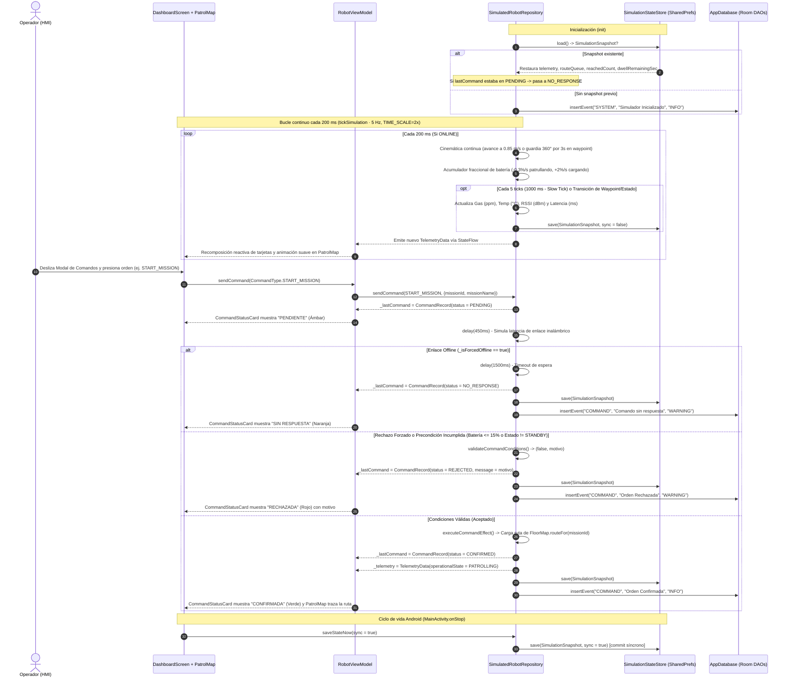
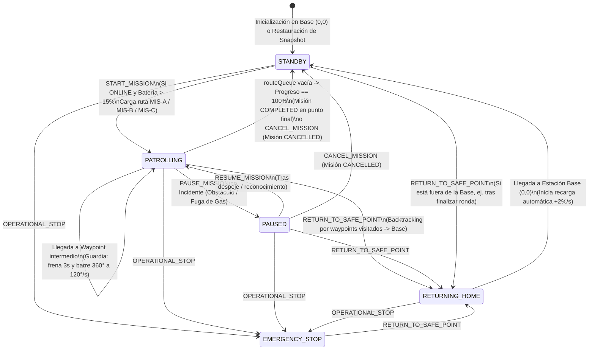
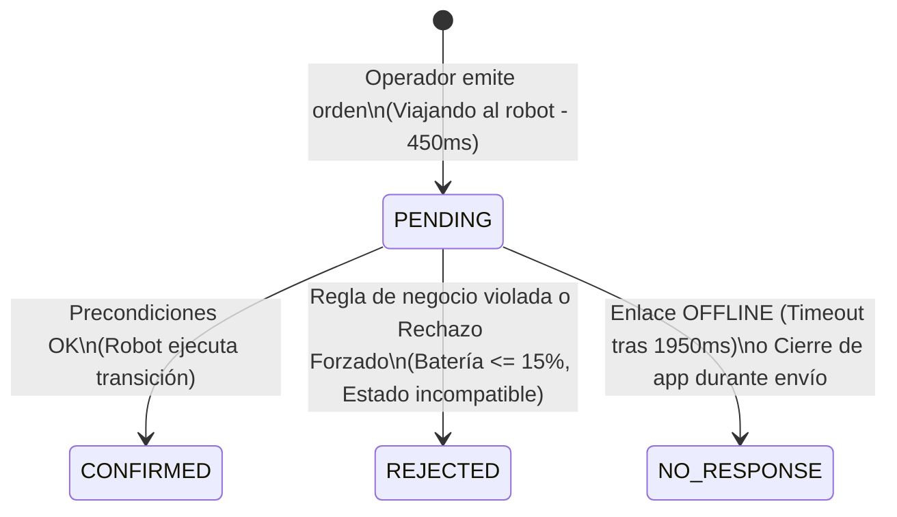

# Arquitectura de Software, Repository Simulado, Mapa 2D y Contratos de Mensajes
**Proyecto:** Interfaz HMI/HRI para Robot de Servicio Unitree G1 (`unitreeg1hmi99`)  
**Cátedra:** Desarrollo de Aplicaciones I — Facultad de Ingeniería y Cs. Exactas, UADE  
**Plataforma Robótica:** Unitree G1 (Humanoide Bípedo)  
**Paquete Base:** `ar.edu.uade.unitreeg1hmi99`  
**Rama:** `master`  

---

## Índice
1. [Diagramas de Arquitectura](#1-diagramas-de-arquitectura)
   - [1.1. Diagrama General de Capas (MVVM + Clean Architecture)](#11-diagrama-general-de-capas-mvvm--clean-architecture)
   - [1.2. Flujo Unidireccional de Datos (UDF), Cinemática y Persistencia de Estado](#12-flujo-unidireccional-de-datos-udf-cinemática-y-persistencia-de-estado)
   - [1.3. Máquina de Estados Operativos y Ciclo de Vida de Órdenes](#13-máquina-de-estados-operativos-y-ciclo-de-vida-de-órdenes)
   - [1.4. Estructura de Paquetes del Proyecto](#14-estructura-de-paquetes-del-proyecto)
2. [Repository Simulado, Mapa 2D y Persistencia de Estado Activo](#2-repository-simulado-mapa-2d-y-persistencia-de-estado-activo)
   - [2.1. Desacoplamiento mediante Interfaz (`RobotRepository.kt`)](#21-desacoplamiento-mediante-interfaz-robotrepositorykt)
   - [2.2. Modelo del Plano 2D y Rutas por Misión (`MapModel.kt` y `PatrolMap.kt`)](#22-modelo-del-plano-2d-y-rutas-por-misión-mapmodelkt-y-patrolmapkt)
   - [2.3. Motor de Simulación Cinemática 100% Offline (`SimulatedRobotRepository.kt`)](#23-motor-de-simulación-cinemática-100-offline-simulatedrobotrepositorykt)
   - [2.4. Persistencia de Estado de Misión Activa (`SimulationStateStore.kt`)](#24-persistencia-de-estado-de-misión-activa-simulationstatestorekt)
   - [2.5. Código Principal del Repository Simulado](#25-código-principal-del-repository-simulado)
3. [Ejemplos de Mensajes (Contratos JSON Simulados)](#3-ejemplos-de-mensajes-contratos-json-simulados)
   - [3.1. Mensajes de Telemetría (Robot $\rightarrow$ HMI)](#31-mensajes-de-telemetría-robot--hmi)
   - [3.2. Mensajes de Comandos (HMI $\rightarrow$ Robot)](#32-mensajes-de-comandos-hmi--robot)
   - [3.3. Mensajes de Respuesta de Comandos (Robot $\rightarrow$ HMI)](#33-mensajes-de-respuesta-de-comandos-robot--hmi)
   - [3.4. Registros de Persistencia y Auditoría Local (Room SQLite)](#34-registros-de-persistencia-y-auditoría-local-room-sqlite)
   - [3.5. Instantánea de Estado Activo (`SimulationSnapshot` en SharedPreferences)](#35-instantánea-de-estado-activo-simulationsnapshot-en-sharedpreferences)

---

## 1. Diagramas de Arquitectura

La aplicación sigue el patrón **MVVM (Model-View-ViewModel)** con principios de **Clean Architecture** y **Flujo Unidireccional de Datos (UDF)** sobre **Jetpack Compose** (con paleta industrial inspirada en **ISA-101**) y **Kotlin Coroutines / StateFlow**.

### 1.1. Diagrama General de Capas (MVVM + Clean Architecture)

```mermaid
flowchart TD
    subgraph UI_LAYER ["Capa de Presentación (UI - Jetpack Compose + Tema Industrial ISA-101)"]
        MA["MainActivity.kt\n(enableEdgeToEdge + onStop -> saveStateNow)"]
        NAV["AppNavigation.kt\n(Scaffold + Crossfade + Bottom NavigationBar)"]
        S1["RobotSelectionScreen.kt\n(Ficha Técnica G1, Sensores y HRI)"]
        S2["DashboardScreen.kt\n(Supervisión, Telemetría, Mapa 2D y Modal Comandos)"]
        S3["AlertsScreen.kt\n(Centro de Alertas y Reconocimiento)"]
        S4["HistoryScreen.kt\n(Auditoría Room: Misiones y Eventos)"]
        S5["ScenariosScreen.kt\n(Monitor en Vivo + 5 Escenarios TP)"]
        MAP_UI["PatrolMap.kt\n(Canvas 2D Colapsable: Zonas, Ruta, Robot, Cono 360°)"]
        COMP["CommonComponents.kt\n(Badges Simétricos, CommandStatusCard, ConfirmDialog)"]
        THEME["ui/theme/ (Color.kt, Theme.kt, Type.kt)\nPaleta Semántica HMI ISA-101"]

        MA --> NAV
        NAV --> S1 & S2 & S3 & S4 & S5
        S2 --> MAP_UI & COMP
        S3 & S4 & S5 --> COMP
        UI_LAYER --- THEME
    end

    subgraph VM_LAYER ["Capa de Gestión de Estado (ViewModels)"]
        RVM["RobotViewModel.kt\nuiState: StateFlow<RobotUiState>\n(telemetry, lastCommand, floorMap, plannedRoute, routeReached)"]
        HVM["HistoryViewModel.kt\nuiState: StateFlow<HistoryUiState>"]
    end

    subgraph DOMAIN_LAYER ["Capa de Dominio (100% Kotlin Puro · Sin Dependencias de Android/Room)"]
        REPO_INT{{"<<interface>>\ndomain/repository/RobotRepository.kt"}}
        USE_CASE["domain/usecase/\nValidateRobotCommandUseCase.kt\n(Reglas de Habilitación y Precondiciones)"]
        MODELS["domain/model/\nTelemetryData.kt, RobotEnums.kt,\nMapModel.kt, AuditModels.kt (MissionRecord, EventLogRecord)"]
    end

    subgraph DATA_LAYER ["Capa de Datos (Simulación Cinemática Offline + Persistencia Dual)"]
        SIM_REPO["SimulatedRobotRepository.kt\n(Singleton · Motor 100% Offline)"]

        subgraph SIM_ENGINE ["Motor Interno en Corrutinas (simLock)"]
            FAST_TICK["Tick Rápido (5 Hz / 200 ms · TIME_SCALE=2x)\nCinemática Continua, Guardia 360° en Waypoints,\nBacktracking a Base y Acumulador de Batería"]
            SLOW_TICK["Tick Lento (1 Hz / 1000 ms)\nSensores Ambientales (Gas/Temp), RSSI/Latencia"]
            VALIDATOR["Validador de Precondiciones\ny Máquina de Estados"]
        end

        subgraph STATE_STORE ["Persistencia de Estado Activo (SharedPreferences)"]
            SSTORE_INT{{"<<interface>>\nSimulationStateStore.kt"}}
            SP_STORE["SharedPrefsSimulationStateStore\n(unitree_g1_sim_state · SimulationSnapshot JSON)"]
        end

        subgraph ROOM_DB ["Persistencia de Auditoría e Historial (Room SQLite: unitree_g1_hmi.db)"]
            DB[("AppDatabase.kt")]
            MDAO["MissionHistoryDao.kt"]
            EDAO["EventLogDao.kt"]
            MENT["MissionHistoryEntity\n(Tabla: mission_history)"]
            EENT["EventLogEntity\n(Tabla: event_logs)"]
        end
    end

    %% Relaciones UI <-> ViewModel
    S2 & S3 & S5 -- "Observa StateFlow (collectAsStateWithLifecycle)" --> RVM
    S2 & S3 & S5 -- "Envía Eventos / Comandos" --> RVM
    S4 -- "Observa Historial (collectAsStateWithLifecycle)" --> HVM

    %% Relaciones ViewModel <-> Domain
    RVM -- "Combina telemetry, lastCommand,\nisForcedOffline, isForcedRejection, floorMap" --> REPO_INT
    RVM -- "Evalúa CommandAvailability" --> USE_CASE
    HVM -- "Consume Flows de MissionRecord y EventLogRecord" --> REPO_INT
    REPO_INT --- MODELS
    USE_CASE --- MODELS

    %% Implementación del Repositorio
    SIM_REPO -. "Implementa" .-> REPO_INT
    SIM_REPO -- "Valida Precondiciones" --> USE_CASE
    SIM_REPO --> FAST_TICK & SLOW_TICK & VALIDATOR

    %% Relaciones Repository <-> SimulationStateStore
    SIM_REPO -- "Guarda y restaura SimulationSnapshot" --> SSTORE_INT
    SP_STORE -. "Implementa" .-> SSTORE_INT

    %% Relaciones Repository <-> Room
    SIM_REPO -- "Persiste misiones y logs\n(Dispatchers.IO)" --> MDAO & EDAO
    DB --> MDAO & EDAO
    MDAO --> MENT
    EDAO --> EENT
```

#### Responsabilidades por Capa:
1. **Capa UI (`ui/screens`, `ui/components`, `ui/navigation`, `ui/theme`):**
   - Renderiza declarativamente el estado expuesto por los ViewModels mediante `collectAsStateWithLifecycle()`.
   - [`PatrolMap.kt`](file:///d:/androidProjects/unitreeg1hmi99/app/src/main/java/ar/edu/uade/unitreeg1hmi99/ui/components/PatrolMap.kt) dibuja en un `Canvas` 2D colapsable el plano del edificio (`FloorMap`), la ruta planificada (`plannedRoute`), el tramo completado (`routeReached`), la posición suavizada del robot, su cono de visión y las alertas espaciales, sin acoplarse al simulador.
   - [`DashboardScreen.kt`](file:///d:/androidProjects/unitreeg1hmi99/app/src/main/java/ar/edu/uade/unitreeg1hmi99/ui/screens/DashboardScreen.kt) integra el botón flotante fijo de acceso rápido al mapa (`FixedMapQuickToggleButton`) y el modal inferior deslizable de órdenes (`SwipeableCommandsBottomModal`), consumiendo `state.commandAvailability` precalculado.
   - [`RobotUiMappers.kt`](file:///d:/androidProjects/unitreeg1hmi99/app/src/main/java/ar/edu/uade/unitreeg1hmi99/ui/components/RobotUiMappers.kt) mapea los enums de dominio puros a recursos `@StringRes` de Android.
   - [`MainActivity.kt`](file:///d:/androidProjects/unitreeg1hmi99/app/src/main/java/ar/edu/uade/unitreeg1hmi99/MainActivity.kt) invoca `robotViewModel.saveSimulationState(sync = true)` en `onStop()` para garantizar que ninguna misión en curso se pierda al pasar a segundo plano o cerrar la app.
2. **Capa ViewModel (`ui/viewmodel`):**
   - [`RobotViewModel`](file:///d:/androidProjects/unitreeg1hmi99/app/src/main/java/ar/edu/uade/unitreeg1hmi99/ui/viewmodel/RobotViewModel.kt) combina reactivamente 5 flujos del repositorio y de la vista (`telemetry`, `lastCommand`, `isForcedOffline`, `isForcedRejection`, `_selectedMission`) más los estados de los modales de confirmación (`_showEmergencyDialog`, `_showCancelDialog`) en un único `StateFlow<RobotUiState>` inmutable, calculando además `commandAvailability` (mediante [`ValidateRobotCommandUseCase`](file:///d:/androidProjects/unitreeg1hmi99/app/src/main/java/ar/edu/uade/unitreeg1hmi99/domain/usecase/ValidateRobotCommandUseCase.kt)), `plannedRoute` y `routeReached` para el mapa 2D.
   - [`HistoryViewModel`](file:///d:/androidProjects/unitreeg1hmi99/app/src/main/java/ar/edu/uade/unitreeg1hmi99/ui/viewmodel/HistoryViewModel.kt) expone reactivamente el historial de misiones (`MissionRecord`) y eventos (`EventLogRecord`) como modelos de dominio puros.
3. **Capa Domain (`domain/model`, `domain/repository`, `domain/usecase`):**
   - 100% Kotlin puro, sin dependencias del framework Android ni de anotaciones de Room.
   - [`RobotRepository`](file:///d:/androidProjects/unitreeg1hmi99/app/src/main/java/ar/edu/uade/unitreeg1hmi99/domain/repository/RobotRepository.kt) define el contrato estricto de comunicación (incluyendo `floorMap`, `telemetry`, `lastCommand`, flujos de dominio `MissionRecord`/`EventLogRecord`, comandos, escenarios y `saveStateNow`).
   - [`ValidateRobotCommandUseCase`](file:///d:/androidProjects/unitreeg1hmi99/app/src/main/java/ar/edu/uade/unitreeg1hmi99/domain/usecase/ValidateRobotCommandUseCase.kt) centraliza las reglas de negocio de precondiciones y habilitación de comandos (`CommandAvailability`).
4. **Capa Data (`data/repository`, `data/mapper`, `data/local`):**
   - [`SimulatedRobotRepository`](file:///d:/androidProjects/unitreeg1hmi99/app/src/main/java/ar/edu/uade/unitreeg1hmi99/data/repository/SimulatedRobotRepository.kt) implementa `RobotRepository` y ejecuta el motor de simulación cinemática 100% offline.
   - [`AuditMappers.kt`](file:///d:/androidProjects/unitreeg1hmi99/app/src/main/java/ar/edu/uade/unitreeg1hmi99/data/mapper/AuditMappers.kt) transforma las entidades de base de datos (`MissionHistoryEntity`, `EventLogEntity`) en modelos de dominio (`MissionRecord`, `EventLogRecord`).
   - **Room SQLite ([`AppDatabase.kt`](file:///d:/androidProjects/unitreeg1hmi99/app/src/main/java/ar/edu/uade/unitreeg1hmi99/data/local/AppDatabase.kt)):** gestiona `unitree_g1_hmi.db` para el historial permanente de misiones finalizadas/canceladas (`mission_history`) y logs de auditoría (`event_logs`).
   - **Instantánea de Simulación ([`SimulationStateStore.kt`](file:///d:/androidProjects/unitreeg1hmi99/app/src/main/java/ar/edu/uade/unitreeg1hmi99/data/local/SimulationStateStore.kt)):** `SharedPrefsSimulationStateStore` serializa en JSON el estado vivo del simulador (`SimulationSnapshot`) en `SharedPreferences` (`unitree_g1_sim_state`) para sobrevivir cierres de la app sin contaminar el esquema de auditoría de Room.

---

### 1.2. Flujo Unidireccional de Datos (UDF), Cinemática y Persistencia de Estado



---

### 1.3. Máquina de Estados Operativos y Ciclo de Vida de Órdenes

#### Máquina de Estados del Robot (`OperationalState`)



#### Ciclo de Vida de cada Comando (`CommandStatus`)



---

### 1.4. Estructura de Paquetes del Proyecto

```text
ar.edu.uade.unitreeg1hmi99/
├── MainActivity.kt                        # Punto de entrada, Composition Root y guardado vía ViewModel en onStop()
├── domain/                                # Capa de Dominio (100% Kotlin Puro, sin Android ni Room)
│   ├── model/
│   │   ├── AuditModels.kt                 # MissionRecord y EventLogRecord (desacoplados de Room)
│   │   ├── MapModel.kt                    # MapWaypoint, MapZone, ZoneKind, FloorMap y BuildingMap
│   │   ├── TelemetryData.kt               # Modelo inmutable con las 8+3 variables + waypointsReached
│   │   └── RobotEnums.kt                  # OperationalState, ConnectionState, CommandType, CommandStatus, AlertItem
│   ├── repository/
│   │   └── RobotRepository.kt             # Interfaz desacoplada del repositorio en la capa de dominio
│   └── usecase/
│       └── ValidateRobotCommandUseCase.kt # Reglas de negocio de habilitación (CommandAvailability) y validación
├── data/                                  # Capa de Datos (Simulador Offline + Persistencia Dual)
│   ├── local/
│   │   ├── AppDatabase.kt                 # Instancia Singleton Room (unitree_g1_hmi.db)
│   │   ├── SimulationStateStore.kt        # SimulationSnapshot y SharedPrefsSimulationStateStore
│   │   ├── dao/
│   │   │   ├── MissionHistoryDao.kt       # Consultas Flow<List<MissionHistoryEntity>>
│   │   │   └── EventLogDao.kt             # Consultas Flow<List<EventLogEntity>>
│   │   └── entity/
│   │       ├── MissionHistoryEntity.kt    # Tabla mission_history
│   │       └── EventLogEntity.kt          # Tabla event_logs
│   ├── mapper/
│   │   └── AuditMappers.kt                # Mapeo MissionHistoryEntity/EventLogEntity -> Modelos de Dominio
│   └── repository/
│       └── SimulatedRobotRepository.kt    # Motor de simulación cinemática 100% offline (200ms / 1s)
└── ui/                                    # Capa de Presentación (MVVM + UDF + Jetpack Compose)
    ├── components/
    │   ├── CommonComponents.kt            # Badges simétricos, CommandStatusCard, SectionHeader, ConfirmDialog
    │   ├── PatrolMap.kt                   # Mapa 2D interactivo y colapsable en Canvas
    │   └── RobotUiMappers.kt              # Extensiones @StringRes para mapear enums de dominio a recursos UI
    ├── navigation/
    │   └── AppNavigation.kt               # Scaffold con Crossfade y NavigationBar de 5 destinos
    ├── screens/
    │   ├── RobotSelectionScreen.kt        # Ficha técnica del Unitree G1, sensores y justificación HRI
    │   ├── DashboardScreen.kt             # Supervisión en vivo, PatrolMap, botón fijo y modal deslizable de comandos
    │   ├── AlertsScreen.kt                # Centro de alertas activas, contadores y reconocimiento
    │   ├── HistoryScreen.kt               # Historial de dominio (MissionRecord y EventLogRecord)
    │   └── ScenariosScreen.kt             # Monitor en vivo + disparadores de los 5 escenarios del TP
    ├── theme/
    │   ├── Color.kt                       # Paleta semántica industrial HMI (inspirada en ISA-101)
    │   ├── Theme.kt                       # Esquemas Light/Dark con dynamicColor = false
    │   └── Type.kt                        # Jerarquía tipográfica HMI
    └── viewmodel/
        ├── RobotViewModel.kt              # Estado reactivo principal, CommandAvailability, rutas 2D y órdenes
        └── HistoryViewModel.kt            # Observación reactiva de historial en modelos de dominio
```

Documentos complementarios en [``](file:///d:/androidProjects/unitreeg1hmi99/docs/):
- [`contrato-json.md`](file:///d:/androidProjects/unitreeg1hmi99/docs/contrato-json.md): Especificación del contrato JSON propuesto (telemetría, comandos, respuestas y alertas).
- [`mapa-2d.md`](file:///d:/androidProjects/unitreeg1hmi99/docs/mapa-2d.md): Documentación funcional y convenciones geométricas del módulo de mapa 2D.
- [`SimulatedRobotRepositoryTest.kt`](file:///d:/androidProjects/unitreeg1hmi99/app/src/test/java/ar/edu/uade/unitreeg1hmi99/SimulatedRobotRepositoryTest.kt): Suite de 15 pruebas unitarias de cinemática, rutas, caso de uso de validación de comandos y persistencia de estado.

---

## 2. Repository Simulado, Mapa 2D y Persistencia de Estado Activo

### 2.1. Desacoplamiento mediante Interfaz (`RobotRepository.kt`)

La arquitectura aísla por completo la fuente de datos detrás de la interfaz [`RobotRepository`](file:///d:/androidProjects/unitreeg1hmi99/app/src/main/java/ar/edu/uade/unitreeg1hmi99/domain/repository/RobotRepository.kt):

```kotlin
package ar.edu.uade.unitreeg1hmi99.domain.repository

import ar.edu.uade.unitreeg1hmi99.domain.model.CommandRecord
import ar.edu.uade.unitreeg1hmi99.domain.model.CommandType
import ar.edu.uade.unitreeg1hmi99.domain.model.EventLogRecord
import ar.edu.uade.unitreeg1hmi99.domain.model.FloorMap
import ar.edu.uade.unitreeg1hmi99.domain.model.MissionRecord
import ar.edu.uade.unitreeg1hmi99.domain.model.TelemetryData
import kotlinx.coroutines.flow.Flow
import kotlinx.coroutines.flow.StateFlow

interface RobotRepository {
    /** Plano 2D del entorno, waypoints y rutas de cada misión */
    val floorMap: FloorMap

    /** Flujo continuo de telemetría dinámica en tiempo real */
    val telemetry: StateFlow<TelemetryData>

    /** Registro de la última orden emitida y su estado (PENDING, CONFIRMED, REJECTED, NO_RESPONSE) */
    val lastCommand: StateFlow<CommandRecord?>

    /** Banderas observables de simulación de fallas para mantener sincronizada la UI */
    val isForcedOffline: StateFlow<Boolean>
    val isForcedRejection: StateFlow<Boolean>

    /** Emisión de comandos con validación de condiciones de habilitación y simulación de respuesta */
    suspend fun sendCommand(type: CommandType, parameters: Map<String, String> = emptyMap()): CommandRecord

    /** Reconocimiento de alertas por parte del operador */
    suspend fun acknowledgeAlert(alertId: String)

    /** Desestimar modal de misión completada tras tomar una decisión */
    fun dismissMissionCompleted()

    /** Flujos de auditoría expuestos como modelos de dominio puros (desacoplados de Room) */
    fun getMissionHistory(): Flow<List<MissionRecord>>
    fun getEventLogs(): Flow<List<EventLogRecord>>
    suspend fun clearHistory()

    // --- Disparadores para demostración de los 5 escenarios de prueba de la consigna ---
    fun toggleDisconnection(forceOffline: Boolean)
    fun triggerLowBattery(percentage: Int = 12)
    fun triggerObstacleIncident()
    fun triggerServiceAlert(gasPpm: Double = 98.0, tempCelsius: Double = 52.0)
    fun toggleForceRejectCommands(reject: Boolean)
    fun resetSimulation()

    /** Persiste de inmediato el estado actual de la simulación (por ej. al pasar a segundo plano). */
    fun saveStateNow(sync: Boolean = true) {}
}
```

---

### 2.2. Modelo del Plano 2D y Rutas por Misión (`MapModel.kt` y `PatrolMap.kt`)

Definido en [`MapModel.kt`](file:///d:/androidProjects/unitreeg1hmi99/app/src/main/java/ar/edu/uade/unitreeg1hmi99/domain/model/MapModel.kt):
* **`FloorMap`:** contiene los límites métricos del edificio (`minX = -2f`, `minY = -2f`, `maxX = 25f`, `maxY = 18f`), las 8 salas rectangulares (`MapZone` con `ZoneKind`), la estación base `(0, 0)`, la lista maestra de 8 `MapWaypoint` y el mapa de rutas por misión (`missionRoutes: Map<String, List<Int>>`).
* **Rutas diferenciadas por plantilla:**
  - `MIS-A` (*Ronda Integral del Edificio*): índices `0, 1, 2, 3, 4, 5, 6, 7` (8 waypoints).
  - `MIS-B` (*Inspección Técnica de Tableros*): índices `2, 3, 4, 5, 7` (5 waypoints técnicos).
  - `MIS-C` (*Patrullaje Perimetral y Accesos*): índices `0, 2, 3, 4` (4 waypoints de acceso y salida).
* **Visualización en [`PatrolMap.kt`](file:///d:/androidProjects/unitreeg1hmi99/app/src/main/java/ar/edu/uade/unitreeg1hmi99/ui/components/PatrolMap.kt):**
  - Interpola posición (`robotX`, `robotY`) y desenrolla el ángulo `headingDeg` mediante `animateFloatAsState` (220 ms) para evitar saltos entre `350°` y `10°`.
  - Mantiene una estela de hasta 80 puntos (`trail`) y permite tocar cualquier waypoint para consultar su nombre y distancia euclidiana al robot.
  - Puede colapsarse/abrirse tanto desde su cabecera como desde el botón flotante fijo (`FixedMapQuickToggleButton`) en la esquina inferior derecha de `DashboardScreen`.

---

### 2.3. Motor de Simulación Cinemática 100% Offline (`SimulatedRobotRepository.kt`)

La clase [`SimulatedRobotRepository`](file:///d:/androidProjects/unitreeg1hmi99/app/src/main/java/ar/edu/uade/unitreeg1hmi99/data/repository/SimulatedRobotRepository.kt) ejecuta un bucle determinístico protegido por `simLock`:

1. **Tick Rápido (`TICK_MS = 200L` · 5 Hz con `TIME_SCALE = 2f`):**
   - **Avance continuo entre waypoints:** en estado `PATROLLING`, cuando `dwellRemainingSec <= 0f`, el robot avanza en línea recta hacia el siguiente waypoint de `routeQueue` a `PATROL_SPEED_MPS = 0.85f` ($\pm 0.05\text{ m/s}$), orientando `headingDeg` con `atan2(dy, dx)` y calculando `missionProgress` según la distancia poligonal restante (`remainingDistance / pathTotalDistance`).
   - **Pausa de guardia y barrido 360°:** al alcanzar un waypoint intermedio (`dist <= budget`), incrementa `reachedCount`, frena (`isMoving = false`, `speedMps = 0f`) e inicia una guardia de `DWELL_SECONDS = 3f` durante la cual rota su orientación a `SCAN_DEG_PER_SEC = 120f` (completando un giro de 360° visible en el cono del mapa 2D).
   - **Detección determinista y anónima de personas:** mientras realiza la guardia en zonas restringidas, reporta `detectedPersonsCount = 2` en *Oficinas* y `1` en *Depósito* (`0` mientras está en movimiento o en otras zonas).
   - **Retorno a base por backtracking (`RETURNING_HOME`):** al ejecutarse `RETURN_TO_SAFE_POINT`, arma la ruta `currentRoute.take(reachedCount).reversed() + baseStation` y regresa a `RETURN_SPEED_MPS = 0.70f` hasta `(0.0, 0.0)`, donde pasa a `STANDBY` y activa `isCharging = true`.
   - **Acumulador fraccional de batería (`batteryAccum`):** desgasta `-0.3%/s` en patrullaje y recarga `+2.0%/s` acoplado en base; al caer a $\le 15\%$ emite automáticamente la alerta `BATTERY_LOW`.
2. **Tick Lento (`SLOW_TICK_EVERY = 5L` · 1 Hz / cada 1000 ms):**
   - Refresca `smokeGasPpm` (`12.0–15.0 ppm` si no hay alerta de gas activa), `ambientTemperatureCelsius` (`21.0–22.5 °C`), `rssiDbm` (`-55 ± 4 dBm`) y `latencyMs` (`24–33 ms`).

---

### 2.4. Persistencia de Estado de Misión Activa (`SimulationStateStore.kt`)

Implementada en [`SimulationStateStore.kt`](file:///d:/androidProjects/unitreeg1hmi99/app/src/main/java/ar/edu/uade/unitreeg1hmi99/data/local/SimulationStateStore.kt):
* `SimulationSnapshot` encapsula tanto el estado público (`telemetry`, `lastCommand`, `isForcedOffline`, `isForcedRejection`) como el estado cinemático interno (`missionStartTime`, `maxRecordedGas`, `maxRecordedTemp`, `routeQueue`, `currentRoute`, `pathTotalDistance`, `returnStartProgress`, `reachedCount`, `dwellRemainingSec`, `batteryAccum`, `tickCounter`).
* `SharedPrefsSimulationStateStore` codifica y decodifica el `SimulationSnapshot` en JSON dentro de `SharedPreferences` (`unitree_g1_sim_state` / `simulation_snapshot_v1`).
* Si la aplicación se cierra y se vuelve a abrir en medio de un patrullaje, pausa, alerta o retorno a base, `restoreState()` reconstruye la cola de waypoints y continúa exactamente desde la misma posición y porcentaje.

---

### 2.5. Código Principal del Repository Simulado

Extracto de [`SimulatedRobotRepository.kt`](file:///d:/androidProjects/unitreeg1hmi99/app/src/main/java/ar/edu/uade/unitreeg1hmi99/data/repository/SimulatedRobotRepository.kt):

```kotlin
class SimulatedRobotRepository(
    private val missionDao: MissionHistoryDao,
    private val eventDao: EventLogDao,
    private val scope: CoroutineScope = CoroutineScope(Dispatchers.Default),
    override val floorMap: FloorMap = BuildingMap.default,
    private val stateStore: SimulationStateStore? = null
) : RobotRepository {

    private val baseStation = floorMap.base

    private val _telemetry = MutableStateFlow(
        TelemetryData(
            robotId = "Unitree-G1-Alpha",
            operationalState = OperationalState.STANDBY,
            zoneName = baseStation.name,
            posX = baseStation.x,
            posY = baseStation.y,
            totalWaypoints = floorMap.routeFor("MIS-A").size,
            isCharging = true
        )
    )
    override val telemetry: StateFlow<TelemetryData> = _telemetry.asStateFlow()

    private val _lastCommand = MutableStateFlow<CommandRecord?>(null)
    override val lastCommand: StateFlow<CommandRecord?> = _lastCommand.asStateFlow()

    private val _isForcedOffline = MutableStateFlow(false)
    override val isForcedOffline: StateFlow<Boolean> = _isForcedOffline.asStateFlow()

    private val _isForcedRejection = MutableStateFlow(false)
    override val isForcedRejection: StateFlow<Boolean> = _isForcedRejection.asStateFlow()

    private val simLock = Any()
    private val routeQueue = ArrayDeque<MapWaypoint>()
    private var currentRoute: List<MapWaypoint> = floorMap.waypoints
    private var pathTotalDistance = 0f
    private var returnStartProgress = 0f
    private var reachedCount = 0
    private var dwellRemainingSec = 0f
    private var batteryAccum = 0f
    private var tickCounter = 0L

    init {
        val restored = restoreState()
        startSimulationLoop()
        if (!restored) {
            logEventAsync("SYSTEM", "Simulador Unitree G1 Inicializado", "Listo para supervisión offline", "INFO")
        }
    }

    override fun saveStateNow(sync: Boolean) {
        val snapshot = synchronized(simLock) { snapshotLocked() }
        stateStore?.save(snapshot, sync)
    }
}
```

---

## 3. Ejemplos de Mensajes (Contratos JSON Simulados)

> [!NOTE]
> Además de los ejemplos siguientes (que reflejan la estructura exacta de los modelos Kotlin [`TelemetryData`](file:///d:/androidProjects/unitreeg1hmi99/app/src/main/java/ar/edu/uade/unitreeg1hmi99/domain/model/TelemetryData.kt), [`CommandRecord`](file:///d:/androidProjects/unitreeg1hmi99/app/src/main/java/ar/edu/uade/unitreeg1hmi99/domain/model/RobotEnums.kt) y [`SimulationSnapshot`](file:///d:/androidProjects/unitreeg1hmi99/app/src/main/java/ar/edu/uade/unitreeg1hmi99/data/local/SimulationStateStore.kt)), en [`contrato-json.md`](file:///d:/androidProjects/unitreeg1hmi99/docs/contrato-json.md) se documenta la especificación agrupada del protocolo de red propuesto entre el robot y la app.

---

### 3.1. Mensajes de Telemetría (Robot $\rightarrow$ HMI)
**Tópico / Endpoint equivalente:** `GET /api/v1/robots/Unitree-G1-Alpha/telemetry` (o stream WebSocket `ws://unitree-g1.local/telemetry`)

#### Ejemplo 1: Robot en Base de Carga en Espera (`STANDBY`)
```json
{
  "timestamp": 1763504400000,
  "robotId": "Unitree-G1-Alpha",
  "connectionState": "ONLINE",
  "rssiDbm": -52,
  "latencyMs": 24,
  "batteryPercentage": 96,
  "batteryVoltage": 25.15,
  "isCharging": true,
  "operationalState": "STANDBY",
  "missionId": null,
  "missionName": null,
  "missionProgress": 0.0,
  "currentWaypoint": 0,
  "totalWaypoints": 8,
  "waypointsReached": 0,
  "zoneName": "Estación Base de Carga",
  "posX": 0.0,
  "posY": 0.0,
  "headingDeg": 0.0,
  "speedMps": 0.0,
  "isMoving": false,
  "activeAlerts": [],
  "lastUpdateTimestamp": 1763504400000,
  "isDataStale": false,
  "smokeGasPpm": 13.4,
  "ambientTemperatureCelsius": 21.6,
  "detectedPersonsCount": 0,
  "justCompletedMissionName": null
}
```

#### Ejemplo 2: Patrullaje Nominal en Curso (`PATROLLING` — Escenario 1)
```json
{
  "timestamp": 1763504445000,
  "robotId": "Unitree-G1-Alpha",
  "connectionState": "ONLINE",
  "rssiDbm": -56,
  "latencyMs": 27,
  "batteryPercentage": 88,
  "batteryVoltage": 25.05,
  "isCharging": false,
  "operationalState": "PATROLLING",
  "missionId": "MIS-A",
  "missionName": "Ronda Integral del Edificio",
  "missionProgress": 45.5,
  "currentWaypoint": 4,
  "totalWaypoints": 8,
  "waypointsReached": 3,
  "zoneName": "Sala de Servidores y Tablero B",
  "posX": 18.0,
  "posY": 8.0,
  "headingDeg": 135.0,
  "speedMps": 0.85,
  "isMoving": true,
  "activeAlerts": [],
  "lastUpdateTimestamp": 1763504445000,
  "isDataStale": false,
  "smokeGasPpm": 14.1,
  "ambientTemperatureCelsius": 22.3,
  "detectedPersonsCount": 0,
  "justCompletedMissionName": null
}
```

#### Ejemplo 3: Alerta de Batería Baja (`WARNING: BATTERY_LOW` — Escenario 2)
```json
{
  "timestamp": 1763504510000,
  "robotId": "Unitree-G1-Alpha",
  "connectionState": "ONLINE",
  "rssiDbm": -58,
  "latencyMs": 29,
  "batteryPercentage": 12,
  "batteryVoltage": 24.14,
  "isCharging": false,
  "operationalState": "STANDBY",
  "missionId": null,
  "missionName": null,
  "missionProgress": 0.0,
  "currentWaypoint": 2,
  "totalWaypoints": 8,
  "waypointsReached": 2,
  "zoneName": "Pasillo de Aulas 101-105",
  "posX": 8.0,
  "posY": 2.5,
  "headingDeg": 90.0,
  "speedMps": 0.0,
  "isMoving": false,
  "activeAlerts": [
    {
      "id": "a7f29c10-4b88-41d2-9c1a-0012b45ef901",
      "code": "BATTERY_LOW",
      "title": "Batería Baja Crítica",
      "message": "Nivel de batería cayó a 12%. Retorno urgente requerido.",
      "severity": "WARNING",
      "timestamp": 1763504509000,
      "acknowledged": false
    }
  ],
  "lastUpdateTimestamp": 1763504510000,
  "isDataStale": false,
  "smokeGasPpm": 12.9,
  "ambientTemperatureCelsius": 21.8,
  "detectedPersonsCount": 0,
  "justCompletedMissionName": null
}
```

#### Ejemplo 4: Pérdida de Enlace con Datos Congelados (`OFFLINE` / `isDataStale: true` — Escenario 3)
> [!WARNING]
> Al perder conexión, `timestamp`, `lastUpdateTimestamp`, `posX` y `posY` permanecen congelados en el último instante recibido, mientras que `connectionState` pasa a `"OFFLINE"` e `isDataStale` cambia a `true` (mostrando en `PatrolMap` al robot en gris punteado con la alerta *"Última posición conocida — sin enlace"*).

```json
{
  "timestamp": 1763504445000,
  "robotId": "Unitree-G1-Alpha",
  "connectionState": "OFFLINE",
  "rssiDbm": -56,
  "latencyMs": 27,
  "batteryPercentage": 88,
  "batteryVoltage": 25.05,
  "isCharging": false,
  "operationalState": "PATROLLING",
  "missionId": "MIS-A",
  "missionName": "Ronda Integral del Edificio",
  "missionProgress": 45.5,
  "currentWaypoint": 4,
  "totalWaypoints": 8,
  "waypointsReached": 3,
  "zoneName": "Sala de Servidores y Tablero B",
  "posX": 18.0,
  "posY": 8.0,
  "headingDeg": 135.0,
  "speedMps": 0.85,
  "isMoving": true,
  "activeAlerts": [],
  "lastUpdateTimestamp": 1763504445000,
  "isDataStale": true,
  "smokeGasPpm": 14.1,
  "ambientTemperatureCelsius": 22.3,
  "detectedPersonsCount": 0,
  "justCompletedMissionName": null
}
```

#### Ejemplo 5: Incidente por Obstáculo y Freno Preventivo (`PAUSED` + `OBSTACLE_BLOCKED` — Escenario 4)
```json
{
  "timestamp": 1763504620000,
  "robotId": "Unitree-G1-Alpha",
  "connectionState": "ONLINE",
  "rssiDbm": -54,
  "latencyMs": 25,
  "batteryPercentage": 82,
  "batteryVoltage": 24.98,
  "isCharging": false,
  "operationalState": "PAUSED",
  "missionId": "MIS-A",
  "missionName": "Ronda Integral del Edificio",
  "missionProgress": 62.0,
  "currentWaypoint": 5,
  "totalWaypoints": 8,
  "waypointsReached": 4,
  "zoneName": "Salida de Emergencia Este",
  "posX": 22.0,
  "posY": 12.0,
  "headingDeg": 180.0,
  "speedMps": 0.0,
  "isMoving": false,
  "activeAlerts": [
    {
      "id": "c4810e3b-7d12-49a0-8f44-993812ab7712",
      "code": "OBSTACLE_BLOCKED",
      "title": "Obstáculo Detectado en Ruta",
      "message": "Trayectoria bloqueada por más de 10s. Requiere decisión del operador.",
      "severity": "WARNING",
      "timestamp": 1763504619000,
      "acknowledged": false
    }
  ],
  "lastUpdateTimestamp": 1763504620000,
  "isDataStale": false,
  "smokeGasPpm": 13.7,
  "ambientTemperatureCelsius": 22.0,
  "detectedPersonsCount": 1,
  "justCompletedMissionName": null
}
```

#### Ejemplo 6: Alerta Crítica del Servicio por Fuga de Gas y Sobrecalentamiento (`CRITICAL: GAS_LEAK` — Escenario 5)
```json
{
  "timestamp": 1763504700000,
  "robotId": "Unitree-G1-Alpha",
  "connectionState": "ONLINE",
  "rssiDbm": -55,
  "latencyMs": 26,
  "batteryPercentage": 79,
  "batteryVoltage": 24.94,
  "isCharging": false,
  "operationalState": "PAUSED",
  "missionId": "MIS-B",
  "missionName": "Inspección Técnica de Tableros",
  "missionProgress": 50.0,
  "currentWaypoint": 2,
  "totalWaypoints": 5,
  "waypointsReached": 2,
  "zoneName": "Sala de Servidores y Tablero B",
  "posX": 18.0,
  "posY": 8.0,
  "headingDeg": 270.0,
  "speedMps": 0.0,
  "isMoving": false,
  "activeAlerts": [
    {
      "id": "f9102d77-3a19-4e81-b022-558190cd3309",
      "code": "GAS_LEAK",
      "title": "Peligro: Fuga de Gas / Sobrecalentamiento",
      "message": "Lectura anómala en tablero eléctrico (96.5 ppm, 54.0°C). Freno preventivo.",
      "severity": "CRITICAL",
      "timestamp": 1763504699000,
      "acknowledged": false
    }
  ],
  "lastUpdateTimestamp": 1763504700000,
  "isDataStale": false,
  "smokeGasPpm": 96.5,
  "ambientTemperatureCelsius": 54.0,
  "detectedPersonsCount": 0,
  "justCompletedMissionName": null
}
```

---

### 3.2. Mensajes de Comandos (HMI $\rightarrow$ Robot)
**Endpoint equivalente:** `POST /api/v1/robots/Unitree-G1-Alpha/commands`

#### 1. Iniciar Misión (`START_MISSION`)
```json
{
  "id": "CMD-4F8A91B2",
  "type": "START_MISSION",
  "timestamp": 1763504405000,
  "parameters": {
    "missionId": "MIS-A",
    "missionName": "Ronda Integral del Edificio"
  }
}
```

#### 2. Pausar Misión (`PAUSE_MISSION`)
```json
{
  "id": "CMD-7C12D4E9",
  "type": "PAUSE_MISSION",
  "timestamp": 1763504460000,
  "parameters": {}
}
```

#### 3. Reanudar Misión (`RESUME_MISSION`)
```json
{
  "id": "CMD-8E34A0F1",
  "type": "RESUME_MISSION",
  "timestamp": 1763504480000,
  "parameters": {}
}
```

#### 4. Cancelar Misión (`CANCEL_MISSION`)
```json
{
  "id": "CMD-9B55C3D8",
  "type": "CANCEL_MISSION",
  "timestamp": 1763504520000,
  "parameters": {}
}
```

#### 5. Regresar a Punto Seguro / Base (`RETURN_TO_SAFE_POINT`)
```json
{
  "id": "CMD-2A67F9C4",
  "type": "RETURN_TO_SAFE_POINT",
  "timestamp": 1763504630000,
  "parameters": {}
}
```

#### 6. Detención Operativa de Software (`OPERATIONAL_STOP`)
```json
{
  "id": "CMD-0D11E8A7",
  "type": "OPERATIONAL_STOP",
  "timestamp": 1763504710000,
  "parameters": {}
}
```

#### 7. Reconocer Alerta (`ACKNOWLEDGE_ALERT`)
```json
{
  "id": "CMD-6F44B2E1",
  "type": "ACKNOWLEDGE_ALERT",
  "timestamp": 1763504715000,
  "parameters": {
    "alertId": "f9102d77-3a19-4e81-b022-558190cd3309"
  }
}
```

---

### 3.3. Mensajes de Respuesta de Comandos (Robot $\rightarrow$ HMI)

Cada comando emitido por el operador produce un objeto [`CommandRecord`](file:///d:/androidProjects/unitreeg1hmi99/app/src/main/java/ar/edu/uade/unitreeg1hmi99/domain/model/RobotEnums.kt#L51-L57) que transita por los estados `PENDING` $\rightarrow$ (`CONFIRMED` | `REJECTED` | `NO_RESPONSE`).

#### Estado 1: Orden en Curso (`PENDING`)
```json
{
  "id": "CMD-4F8A91B2",
  "type": "START_MISSION",
  "status": "PENDING",
  "timestamp": 1763504405000,
  "message": "Enviando comando al robot..."
}
```

#### Estado 2: Orden Confirmada y Ejecutada (`CONFIRMED`)
```json
{
  "id": "CMD-4F8A91B2",
  "type": "START_MISSION",
  "status": "CONFIRMED",
  "timestamp": 1763504405450,
  "message": "Orden ejecutada con éxito."
}
```

#### Estado 3A: Orden Rechazada por Batería Baja (`REJECTED`)
```json
{
  "id": "CMD-5E91C0A3",
  "type": "START_MISSION",
  "status": "REJECTED",
  "timestamp": 1763504512450,
  "message": "Batería insuficiente (12%). Mínimo requerido: 20%."
}
```

#### Estado 3B: Orden Rechazada por Estado Operativo Incompatible (`REJECTED`)
```json
{
  "id": "CMD-3B72D1F6",
  "type": "PAUSE_MISSION",
  "status": "REJECTED",
  "timestamp": 1763504402450,
  "message": "No hay una misión en patrullaje para pausar."
}
```

#### Estado 4: Sin Respuesta por Desconexión / Timeout (`NO_RESPONSE` — Escenario 3)
```json
{
  "id": "CMD-1C88E4B9",
  "type": "PAUSE_MISSION",
  "status": "NO_RESPONSE",
  "timestamp": 1763504452950,
  "message": "Sin respuesta del robot. Verifique el enlace de comunicaciones."
}
```

---

### 3.4. Registros de Persistencia y Auditoría Local (Room SQLite)

Cada misión finalizada o abortada y cada evento relevante se almacenan localmente en la base de datos SQLite (`unitree_g1_hmi.db`) para su consulta en [`HistoryScreen.kt`](file:///d:/androidProjects/unitreeg1hmi99/app/src/main/java/ar/edu/uade/unitreeg1hmi99/ui/screens/HistoryScreen.kt).

#### Ejemplo de Registro en Tabla `mission_history` (`MissionHistoryEntity`)
```json
[
  {
    "id": 1,
    "missionId": "MIS-A",
    "missionName": "Ronda Integral del Edificio",
    "startTime": 1763504405450,
    "endTime": 1763504445500,
    "status": "COMPLETED",
    "waypointsCompleted": 8,
    "totalWaypoints": 8,
    "maxGasPpm": 14.9,
    "maxTempCelsius": 22.4,
    "incidentsCount": 0,
    "notes": "Ronda finalizada con éxito. Esperando decisión: retorno a base o nueva misión."
  },
  {
    "id": 2,
    "missionId": "MIS-B",
    "missionName": "Inspección Técnica de Tableros",
    "startTime": 1763504680000,
    "endTime": 1763504725000,
    "status": "CANCELLED",
    "waypointsCompleted": 2,
    "totalWaypoints": 5,
    "maxGasPpm": 96.5,
    "maxTempCelsius": 54.0,
    "incidentsCount": 1,
    "notes": "Misión cancelada por el operador."
  }
]
```

#### Ejemplo de Registros en Tabla `event_logs` (`EventLogEntity`)
```json
[
  {
    "id": 101,
    "timestamp": 1763504400000,
    "eventType": "SYSTEM",
    "title": "Simulador Unitree G1 Inicializado",
    "details": "Listo para supervisión offline",
    "severity": "INFO"
  },
  {
    "id": 102,
    "timestamp": 1763504405450,
    "eventType": "COMMAND",
    "title": "Orden Confirmada",
    "details": "Comando START_MISSION ejecutado",
    "severity": "INFO"
  },
  {
    "id": 103,
    "timestamp": 1763504699000,
    "eventType": "SAFETY",
    "title": "Peligro: Fuga de Gas / Sobrecalentamiento",
    "details": "Lectura anómala en tablero eléctrico (96.5 ppm, 54.0°C). Freno preventivo.",
    "severity": "CRITICAL"
  },
  {
    "id": 104,
    "timestamp": 1763504715000,
    "eventType": "ALERT",
    "title": "Alerta Reconocida",
    "details": "Operador reconoció la alerta ID f9102d77-3a19-4e81-b022-558190cd3309",
    "severity": "INFO"
  }
]
```

---

### 3.5. Instantánea de Estado Activo (`SimulationSnapshot` en SharedPreferences)

Ejemplo del payload JSON persistido en `SharedPreferences` (`unitree_g1_sim_state` $\rightarrow$ clave `simulation_snapshot_v1`) por [`SharedPrefsSimulationStateStore`](file:///d:/androidProjects/unitreeg1hmi99/app/src/main/java/ar/edu/uade/unitreeg1hmi99/data/local/SimulationStateStore.kt):

```json
{
  "telemetry": {
    "timestamp": 1763504445000,
    "robotId": "Unitree-G1-Alpha",
    "connectionState": "ONLINE",
    "rssiDbm": -55,
    "latencyMs": 26,
    "batteryPercentage": 88,
    "batteryVoltage": 25.056,
    "isCharging": false,
    "operationalState": "PATROLLING",
    "missionId": "MIS-B",
    "missionName": "Inspección Técnica de Tableros",
    "missionProgress": 41.2,
    "currentWaypoint": 2,
    "totalWaypoints": 5,
    "waypointsReached": 1,
    "zoneName": "Sala de Servidores y Tablero B",
    "posX": 16.4,
    "posY": 6.8,
    "headingDeg": 36.87,
    "speedMps": 0.85,
    "isMoving": true,
    "activeAlerts": [],
    "lastUpdateTimestamp": 1763504445000,
    "isDataStale": false,
    "smokeGasPpm": 14.1,
    "ambientTemperatureCelsius": 22.1,
    "detectedPersonsCount": 0,
    "justCompletedMissionName": null
  },
  "lastCommand": {
    "id": "CMD-4F8A91B2",
    "type": "START_MISSION",
    "status": "CONFIRMED",
    "timestamp": 1763504405450,
    "message": "Orden ejecutada con éxito."
  },
  "isForcedOffline": false,
  "isForcedRejection": false,
  "missionStartTime": 1763504405450,
  "maxRecordedGas": 14.8,
  "maxRecordedTemp": 22.3,
  "routeQueue": [
    { "name": "Sala de Servidores y Tablero B", "x": 18.0, "y": 8.0 },
    { "name": "Salida de Emergencia Este", "x": 22.0, "y": 12.0 },
    { "name": "Depósito de Mantenimiento", "x": 16.0, "y": 15.0 },
    { "name": "Punto Final de Inspección", "x": 8.0, "y": 8.0 }
  ],
  "currentRoute": [
    { "name": "Laboratorio de Robótica e IoT", "x": 14.0, "y": 5.0 },
    { "name": "Sala de Servidores y Tablero B", "x": 18.0, "y": 8.0 },
    { "name": "Salida de Emergencia Este", "x": 22.0, "y": 12.0 },
    { "name": "Depósito de Mantenimiento", "x": 16.0, "y": 15.0 },
    { "name": "Punto Final de Inspección", "x": 8.0, "y": 8.0 }
  ],
  "pathTotalDistance": 43.18,
  "returnStartProgress": 0.0,
  "reachedCount": 1,
  "dwellRemainingSec": 0.0,
  "batteryAccum": -0.42,
  "tickCounter": 195
}
```
