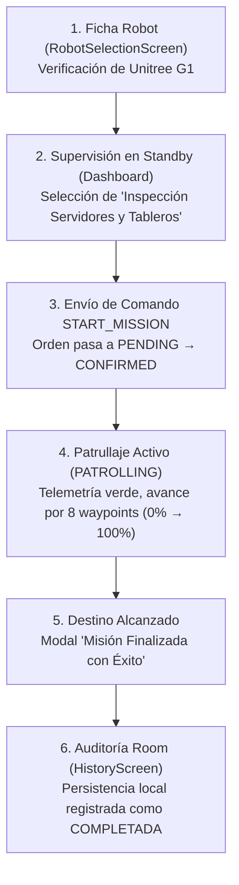
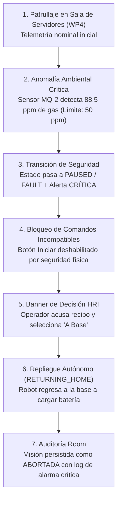

# Guía de Entrega y Prototipo en Figma: HMI Unitree G1
**Cátedra:** Desarrollo de Aplicaciones I — Facultad de Ingeniería y Cs. Exactas, UADE  
**Plataforma Robótica:** Unitree G1 (Humanoide Bípedo de Inspección y Seguridad)  
**Proyecto Android:** `unitreeg1hmi99`  
**Directorio de Entrega:** `d:\androidProjects\unitreeg1hmi99\figma\`  

---

## 1. Resumen Ejecutivo de Cumplimiento (Sección 3 del TP)

La consigna de la **Sección 3: Diseño en Figma** solicita:
> *"Entregar un prototipo navegable con mapa de navegación, componentes reutilizables y estados visuales (normal, deshabilitado, advertencia y error).*  
> *Debe contemplar: selección del robot, panel de supervisión, telemetría, misiones, control, alertas, historial y desconexión. Pueden combinarse vistas si la navegación sigue siendo clara. Mostrar un flujo completo normal y otro con una falla."*

Este paquete contiene la solución integral para dicha consigna:

| Requerimiento de Consigna | Archivo / Recurso Generado | Estado |
| :--- | :--- | :---: |
| **Prototipo Navegable Interactivo** | [figma/index.html](file:///d:/androidProjects/unitreeg1hmi99/figma/index.html) (ejecutable en navegador con mockup de smartphone) | ✅ **100% Cumplido** |
| **Mapa de Navegación** | [export_svg/09_mapa_navegacion.svg](file:///d:/androidProjects/unitreeg1hmi99/figma/export_svg/09_mapa_navegacion.svg) | ✅ **100% Cumplido** |
| **Componentes Reutilizables (UI Kit)** | [export_svg/08_design_system_componentes.svg](file:///d:/androidProjects/unitreeg1hmi99/figma/export_svg/08_design_system_componentes.svg) | ✅ **100% Cumplido** |
| **4 Estados Visuales (Normal, Desh., Adv., Error)** | Especificados en UI Kit y testeables dinámicamente en el prototipo interactivo | ✅ **100% Cumplido** |
| **Selección del Robot** | [export_svg/01_seleccion_robot.svg](file:///d:/androidProjects/unitreeg1hmi99/figma/export_svg/01_seleccion_robot.svg) | ✅ **100% Cumplido** |
| **Supervisión & Misiones (Standby)** | [export_svg/02_supervision_standby_misiones.svg](file:///d:/androidProjects/unitreeg1hmi99/figma/export_svg/02_supervision_standby_misiones.svg) | ✅ **100% Cumplido** |
| **Telemetría & Supervisión en Marcha** | [export_svg/03_supervision_patrullaje_telemetria.svg](file:///d:/androidProjects/unitreeg1hmi99/figma/export_svg/03_supervision_patrullaje_telemetria.svg) | ✅ **100% Cumplido** |
| **Control, Comandos & Modal de Parada** | [export_svg/04_control_comandos_modal_paro.svg](file:///d:/androidProjects/unitreeg1hmi99/figma/export_svg/04_control_comandos_modal_paro.svg) | ✅ **100% Cumplido** |
| **Alertas & Banner de Decisión de Incidente** | [export_svg/05_alertas_decision_incidente.svg](file:///d:/androidProjects/unitreeg1hmi99/figma/export_svg/05_alertas_decision_incidente.svg) | ✅ **100% Cumplido** |
| **Historial y Auditoría Local Room** | [export_svg/06_historial_auditoria.svg](file:///d:/androidProjects/unitreeg1hmi99/figma/export_svg/06_historial_auditoria.svg) | ✅ **100% Cumplido** |
| **Desconexión & Datos Congelados (Stale)** | [export_svg/07_desconexion_red_stale.svg](file:///d:/androidProjects/unitreeg1hmi99/figma/export_svg/07_desconexion_red_stale.svg) | ✅ **100% Cumplido** |
| **Flujo Completo 1: Normal (Éxito)** | Paso a paso guiado en prototipo y documentado en diagrama | ✅ **100% Cumplido** |
| **Flujo Completo 2: Con Falla (Contingencia)** | Paso a paso guiado con fuga de gas (88 ppm), alerta y repliegue seguro | ✅ **100% Cumplido** |

---

## 2. Instrucciones para Importar a Figma en 2 Minutos

Figma permite importar directamente archivos vectoriales SVG manteniendo todos los rectángulos, textos, capas y estilos totalmente editables.

### Pasos rápidos:
1. Abre tu navegador e ingresa a [Figma](https://www.figma.com).
2. Haz clic en **"New design file"** (Nuevo archivo de diseño).
3. Abre el explorador de archivos de Windows en la carpeta:
   `D:\androidProjects\unitreeg1hmi99\figma\export_svg\`
4. **Selecciona los 9 archivos `.svg` y arrástralos (Drag & Drop)** directamente al lienzo en blanco de Figma.
5. Figma creará automáticamente un Frame por cada archivo con todas las capas vectoriales, textos y estilos agrupados.
6. (Opcional) Para armar los links interactivos en Figma:
   - Haz clic en la pestaña **Prototype** en la barra lateral derecha de Figma.
   - Selecciona el botón **"Iniciar"** del Frame 02 y arrastra la flecha azul al Frame 03 (`On click` $\rightarrow$ `Navigate to`).
   - Selecciona el botón **"DETENCIÓN OPERATIVA"** del Frame 03 y arrastra la flecha al Frame 04 (Modal de confirmación).
   - Conecta los botones del **Bottom Navigation Bar** con sus pantallas correspondientes.
7. Haz clic en **Share** (arriba a la derecha), cambia la privacidad a *"Anyone with the link can view"* y copia el enlace público para entregarlo en el informe.

---

## 3. Prototipo Web Interactivo Autónomo

Se incluye un prototipo web de alta fidelidad en:
👉 [D:\androidProjects\unitreeg1hmi99\figma\index.html](file:///D:/androidProjects/unitreeg1hmi99/figma/index.html)

**Para abrirlo:** Simplemente haz doble clic sobre `index.html` en tu explorador de Windows o ábrelo con Chrome, Edge o Firefox.

### Capacidades del Prototipo Web:
1. **Mockup de Smartphone en Tiempo Real:** Barra de estado Android, notch dinámico, barra de navegación inferior funcional Material 3 con badges numéricos de alertas.
2. **Selector de Misiones Interactivo:** Permite elegir entre *"Inspección Crítica: Servidores y Tableros"* (8 waypoints) o *"Ronda Perimetral"* (4 waypoints).
3. **Comandos con Máquina de Estados:** Los botones "Iniciar", "Pausar", "Reanudar", "Cancelar" y "Detención Operativa" ejecutan la lógica de habilitación en tiempo real y actualizan la tarjeta de *Última Orden*.
4. **Simulación de Cinemática:** Al pulsar *"Iniciar"*, la barra de progreso avanza del 0% al 100%, actualiza los waypoints en vivo y desgasta la batería.
5. **Selector de los 4 Estados Visuales:** Permite conmutar con un solo clic entre:
   - 🟢 **Normal:** Valores nominales, conexión online verde, telemetría estable.
   - ⚪ **Deshabilitado:** Batería al 12%, bloquea inicio de nuevas rondas por precondición.
   - 🟡 **Advertencia:** Obstáculo persistente en pasillo, robot en pausa preventiva.
   - 🔴 **Error / Falla:** Desconexión WiFi total, telemetría congelada (*stale*), comandos con timeout.
6. **Demostración de los 2 Flujos Completos:** Dos botones guiados *"Ver Flujo 1: Normal"* y *"Ver Flujo 2: Con Falla"* que guían paso a paso la historia para defender el trabajo práctico.

---

## 4. Detalle de los Dos Flujos Demostrables

### Flujo 1: Completo Normal (Ronda de Inspección Exitosa)

1. **Paso 1 — Selección:** El operador ingresa a la ficha técnica del Unitree G1, corrobora la justificación bípeda y los sensores (LiDAR 3D, sensor de gases MQ-2 y pirómetro térmico) y avanza a Supervisión.
2. **Paso 2 — Configuración:** En estado `STANDBY`, el operador selecciona la misión *"Inspección Crítica: Servidores y Tableros"* (8 waypoints, ~15 min).
3. **Paso 3 — Orden de Marcha:** Presiona el botón *"Iniciar"*. El comando viaja en estado `PENDING` (amarillo) y se confirma en `CONFIRMED` (verde).
4. **Paso 4 — Supervisión y Telemetría:** El robot pasa a `PATROLLING`. La telemetría reporta variables normales (Gas: 18.2 ppm, Temp: 23.4°C, 0 personas, velocidad: 0.72 m/s). La barra de progreso avanza continuamente.
5. **Paso 5 — Cierre:** Al alcanzar el 100%, el robot frena en el punto final de inspección y despliega el diálogo modal de fin de misión.
6. **Paso 6 — Historial:** Se consulta la pestaña de Historial, donde la base de datos Room almacena la entidad con estado `COMPLETED`, duración de 14m 20s y valores ambientales nominales.

---

### Flujo 2: Completo con Falla (Fuga de Gas y Repliegue Seguro)

1. **Paso 1 — Marcha Nominal:** El robot se encuentra patrullando en el Waypoint 4 (Sala de Servidores y Tablero B).
2. **Paso 2 — Disparo de la Falla:** El sensor ambiental reporta un pico crítico de 88.5 ppm de gas/humo y 44.2°C de temperatura en tableros.
3. **Paso 3 — Parada Preventiva:** El sistema pasa de inmediato a `PAUSED` / `FAULT` y genera la alerta roja `CRITICAL: GAS_LEAK_DETECTED` con badge numérico en la pestaña de Alertas.
4. **Paso 4 — Bloqueo Visual (Estado Deshabilitado):** Se bloquea la opción de continuar la marcha ordinaria para evitar riesgos al humanoide y a las instalaciones.
5. **Paso 5 — Decisión del Operador (HRI):** En la pantalla principal se despliega el **Banner de Decisión de Incidente**. El operador presiona *"A Base"* para ordenar el repliegue.
6. **Paso 6 — Retorno Seguro:** El robot adopta el estado `RETURNING_HOME`, recalculando la trayectoria hacia la estación de recarga.
7. **Paso 7 — Auditoría de Incidente:** La misión se persiste en Room como `ABORTADA` (color rojo), guardando el pico de gas registrado (92.4 ppm) y la justificación de intervención humana.

---

## 5. Catálogo del Design System (Componentes Reutilizables)

### 5.1. Tokens de Color Semánticos
* **Primary (Acción Principal / HMI):** `#4F46E5` / Light: `#EEF2FF`
* **Success / Normal (Valores nominales):** `#16A34A` / Light: `#DCFCE7`
* **Warning (Advertencias / Obstáculos / Batería Baja):** `#D97706` / Light: `#FEF3C7`
* **Critical / Error (Falla / Desconexión / Paro):** `#DC2626` / Light: `#FEE2E2`
* **Purple (Regreso a Base):** `#7C3AED` / Light: `#F3E8FF`
* **Neutral / Disabled (Deshabilitado / Inactivo):** `#94A3B8` / Light: `#F1F5F9`

### 5.2. Componentes Reutilizables
1. **`OperationalStateBadge`:** Muestra con código de color el estado actual de la máquina de estados (`STANDBY`, `PATROLLING`, `PAUSED`, `RETURNING_HOME`, `EMERGENCY_STOP`, `FAULT`).
2. **`ConnectivityBadge`:** Señal WiFi en dBm, latencia en milisegundos y bandera visual de datos obsoletos (`isDataStale`).
3. **`BatteryBadge`:** Porcentaje de carga, voltaje nominal (24V - 25.2V) e indicador de recarga dinámica en base.
4. **`ServiceMetricCard`:** Tarjeta para las 3 variables de inspección ambiental (Gas MQ-2, Temperatura y Detección de Personas).
5. **`CommandStatusCard`:** Representa el ciclo de vida de cada orden (`PENDING`, `CONFIRMED`, `REJECTED`, `NO_RESPONSE`).
6. **`IncidentDecisionBanner`:** Banner de intervención ante contingencias con botones de acción directa ("Reanudar", "Cancelar", "A Base").
7. **`ConfirmDialog`:** Modal de doble validación con la **advertencia obligatoria de que la parada por software no sustituye el paro de emergencia físico**.
